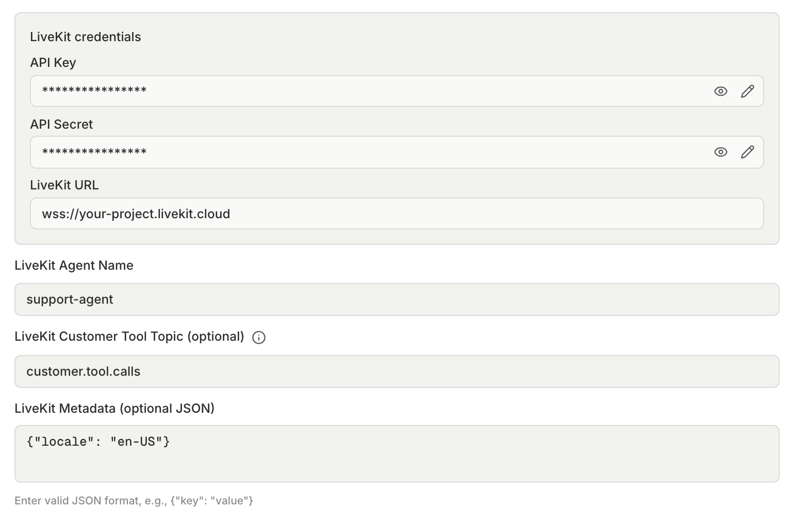
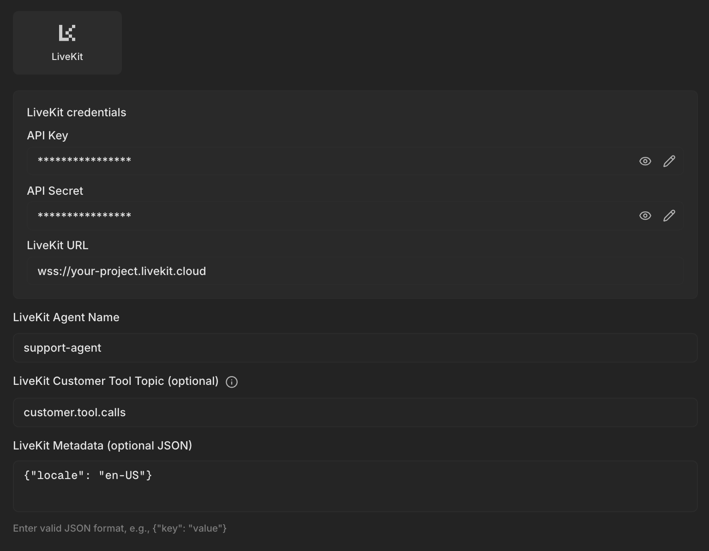

import { Code } from "/snippets/code.jsx";

Connect an agent that runs as a LiveKit Agents worker.

<Tabs>
<Tab title="Test">

## Connect

<Steps>
<Step title="Save the LiveKit keys">
In LiveKit Cloud, copy the API key, API secret, and server URL from **Settings > API keys**. Paste them in Bluejay under **Settings → Integrations → LiveKit**. Skip this step if you use a [token webhook](#token-webhook).
</Step>
<Step title="Create the agent">
Create a Voice agent with the **LiveKit** connection type.



</Step>
<Step title="Set the agent name">
Set **LiveKit Agent Name** to your worker's registered name. Leave it empty only with automatic dispatch.
</Step>
<Step title="Choose the authentication">
Set **Authentication** in the agent's **Connection Settings**:

- **API Key**: Bluejay creates the room token with your saved keys.
- **Token Webhook**: your server creates the room token. Put the full header value, such as `Bearer <token>`, in **Authorization Header (Optional)**.
</Step>
<Step title="Add metadata (optional)">
Bluejay sends **LiveKit Metadata** as the job metadata, with each Digital Human's `livekit_metadata` and the simulation IDs, such as `X-Simulation-Result-Id`, merged in.
</Step>
</Steps>

## Run a test

<Tabs>
<Tab title="Direct">

Test agent logic without phone audio. Bluejay creates a room in your LiveKit project and dispatches your agent into it.

<video controls muted playsInline preload="metadata" className="w-full rounded-xl" src="/videos/connection-settings.mp4"></video>

</Tab>
<Tab title="SIP">

Test the path your phone calls take. Bluejay sends a SIP INVITE to `sip:<number>@<your-project>.sip.livekit.cloud`. The number only needs to match your trunk.

<Steps>
<Step title="Create an inbound trunk">
Create the trunk in the project that owns the SIP host.

```json trunk.json
{ "trunk": { "name": "bluejay-inbound", "numbers": ["+15551230000"] } }
```

```bash
lk sip inbound create trunk.json
```

To read the result ID in your agent, map the `X-Simulation-Result-Id` header to a participant attribute with `lk sip inbound update --id ST_your_trunk_id -`:

```json
{ "headers_to_attributes": { "X-Simulation-Result-Id": "X-Simulation-Result-Id" } }
```

The ID shows in `participant.attributes`, but can be missing when the SIP participant first joins.
</Step>
<Step title="Create a dispatch rule">
Create the rule on the trunk, and set `agentName` to your worker name.

```json dispatch.json
{
  "name": "bluejay-dispatch",
  "rule": { "dispatchRuleIndividual": { "roomPrefix": "sip-" } },
  "trunkIds": ["ST_your_trunk_id"],
  "roomConfig": { "agents": [{ "agentName": "your-agent" }] }
}
```

```bash
lk sip dispatch create dispatch.json
```
</Step>
<Step title="Create the Bluejay agent">
Create a Voice agent with the **SIP** connection type. Set **SIP URI** to `sip:+15551230000@your-project.sip.livekit.cloud`, with the number exactly as in the trunk. See [SIP](/integrations/sip).
</Step>
</Steps>

Bluejay sends each custom SIP header on the INVITE, and all of them as JSON in `X-Custom-Headers`. Read them with the `lk.sip.GetRemoteHeaders` RPC:

```python
import json
from livekit import rtc

participant = await ctx.wait_for_participant()
if participant.kind == rtc.ParticipantKind.PARTICIPANT_KIND_SIP:
    response = await ctx.room.local_participant.perform_rpc(
        destination_identity=participant.identity,
        method="lk.sip.GetRemoteHeaders",
        payload=json.dumps({}),
    )
    headers = json.loads(response)["headers"]
```

</Tab>
<Tab title="Outbound">

For an agent that places calls, use the **Phone** connection type. The **LiveKit** connection type is inbound only.

<Steps>
<Step title="Create the agent">
Create an Outbound Voice agent with the **Phone** connection type, and give each Digital Human a phone number.
</Step>
<Step title="Set a trigger">
Set **Outbound Trigger Webhook URL**, or subscribe a [webhook](/api-reference/webhooks) to `outbound_simulation_started`. Without a trigger, the Digital Humans wait until the run times out.
</Step>
<Step title="Dial the Digital Humans">
When the trigger fires, dial each `phone_number` in the [event payload](/api-reference/webhook/events-webhook), for example with `create_sip_participant`.
</Step>
</Steps>

</Tab>
</Tabs>

## Token webhook

Before each call, Bluejay sends a `POST` to the **Token Webhook URL**:

```json
{
  "room_name": "test-room-812192",
  "participant_identity": "digital-human-812192",
  "agent_name": "your-agent-name",
  "agent_metadata": { "any": "metadata you configured" },
  "sim_conversation_id": 812192
}
```

| Response field | Description |
|---|---|
| `token` | Required. A LiveKit token for the identity with `room_join`, `can_publish`, and <Code>can_subscribe</Code>. Add <Code>can_publish_data</Code> for tool call tracking. The TTL must cover the call. |
| `livekit_url` | Replaces the server URL from the integration. Required if you saved no LiveKit integration. |
| `room_name` | Optional. Replaces the room the Digital Human joins. |

Dispatch your agent with a `RoomAgentDispatch` in the token, or from your server. Bluejay waits 15 seconds and tries up to 3 times on a timeout, `408`, `429`, or `5xx`. A `401` or `403` fails the run with no retry.

## Tool calls

Set **LiveKit Customer Tool Topic**, and publish one data packet on that topic for each tool call.

```python
import json

async def report_tool_call(room, tool_name, parameters, output):
    payload = json.dumps({"name": tool_name, "parameters": parameters, "output": output}).encode()
    await room.local_participant.publish_data(payload, topic="customer.tool.calls")
```

| Field | Description |
|---|---|
| `name` | Required. The tool name. |
| `parameters` | The tool input. |
| `output` | The tool return value. |
| <Code>start_offset_ms</Code> | Milliseconds from call start. |
| `client_ts` | ISO 8601 time. Used when <Code>start_offset_ms</Code> is not set. |
| <Code>invocation_id</Code> | Bluejay drops a second packet with the same ID. |

## Traces

Export OpenTelemetry traces to Bluejay, and link them to the result at shutdown.

```python
import httpx
from opentelemetry import context as otel_context
from opentelemetry.sdk import trace as trace_sdk
from opentelemetry.exporter.otlp.proto.http.trace_exporter import OTLPSpanExporter
from opentelemetry.sdk.trace.export import SimpleSpanProcessor
from opentelemetry.sdk.resources import SERVICE_NAME, Resource
from livekit.agents.telemetry import set_tracer_provider
import opentelemetry.trace as otel_trace

tracer_provider = trace_sdk.TracerProvider(resource=Resource.create({SERVICE_NAME: "my-agent"}))
tracer_provider.add_span_processor(
    SimpleSpanProcessor(
        OTLPSpanExporter("https://otlp.getbluejay.ai/v1/traces", headers={"X-API-KEY": BLUEJAY_API_KEY})
    )
)
set_tracer_provider(tracer_provider)
otel_trace.set_tracer_provider(tracer_provider)

# Before session.start():
span = otel_trace.get_tracer("my-agent").start_span("call")
otel_context.attach(otel_trace.set_span_in_context(span))
trace_ids = [format(span.get_span_context().trace_id, "032x")]

# simulation_result_id: the X-Simulation-Result-Id value from the job metadata
# or, over SIP, from the participant attributes.

async def on_shutdown():
    span.end()
    tracer_provider.force_flush()
    if simulation_result_id:
        async with httpx.AsyncClient(timeout=10) as client:
            res = await client.post(
                "https://api.getbluejay.ai/v1/update-simulation-result",
                json={"simulation_result_id": simulation_result_id, "trace_ids": trace_ids},
                headers={"X-API-Key": BLUEJAY_API_KEY},
            )
            res.raise_for_status()
    tracer_provider.shutdown()

ctx.add_shutdown_callback(on_shutdown)
```

Call `force_flush()` before the POST, or the trace can be missing.

</Tab>
<Tab title="Monitor">

To score your live calls from the worker, use the [SDK](/sdk/livekit). The code and webhook below are the paths that do not install it. Use the code path if you need tool calls and you are not using the SDK.

## Code

Send each finished call to [`/v1/evaluate`](/api-reference/endpoint/evaluate) with its trace, so Bluejay sees the system prompt and tool calls.

```python
import os
from datetime import datetime, timezone

import httpx
import opentelemetry.trace as otel_trace
from livekit.agents import AgentSession, JobContext
from livekit.agents.telemetry import set_tracer_provider
from opentelemetry.exporter.otlp.proto.http.trace_exporter import OTLPSpanExporter
from opentelemetry.sdk import trace as trace_sdk
from opentelemetry.sdk.resources import SERVICE_NAME, Resource
from opentelemetry.sdk.trace.export import BatchSpanProcessor

BLUEJAY_API_KEY = os.environ["BLUEJAY_API_KEY"]
BLUEJAY_AGENT_ID = os.environ["BLUEJAY_AGENT_ID"]

tracer_provider = trace_sdk.TracerProvider(resource=Resource.create({SERVICE_NAME: "my-agent"}))
tracer_provider.add_span_processor(
    BatchSpanProcessor(
        OTLPSpanExporter("https://otlp.getbluejay.ai/v1/traces", headers={"X-API-KEY": BLUEJAY_API_KEY})
    )
)
set_tracer_provider(tracer_provider)
otel_trace.set_tracer_provider(tracer_provider)


async def entrypoint(ctx: JobContext):
    started_at = datetime.now(timezone.utc)
    trace_id = format(otel_trace.get_current_span().get_span_context().trace_id, "032x")

    session = AgentSession(...)

    async def send_to_bluejay():
        transcript = []
        for item in session.history.items:
            if item.type != "message" or item.role not in ("assistant", "user") or not item.text_content:
                continue
            start = item.metrics.get("started_speaking_at", item.created_at)
            end = item.metrics.get("stopped_speaking_at", start)
            transcript.append({
                "speaker": "AGENT" if item.role == "assistant" else "USER",
                "utterance": item.text_content,
                "start_offset_ms": max(0, int((start - started_at.timestamp()) * 1000)),
                "end_offset_ms": max(0, int((end - started_at.timestamp()) * 1000)),
            })
        if not transcript:
            return
        tracer_provider.force_flush()
        async with httpx.AsyncClient(timeout=30) as client:
            res = await client.post(
                "https://api.getbluejay.ai/v1/evaluate",
                json={
                    "agent_id": BLUEJAY_AGENT_ID,
                    "start_time_utc": started_at.isoformat(),
                    "participants": [{"role": "AGENT"}, {"role": "USER"}],
                    "transcript": transcript,
                    "trace_ids": [trace_id],
                },
                headers={"X-API-Key": BLUEJAY_API_KEY},
            )
            res.raise_for_status()

    ctx.add_shutdown_callback(send_to_bluejay)
    await session.start(...)
```

If you also use the webhook, set `bluejay.bypass_webhook` so Bluejay does not get each call twice:

```python
await req.accept(identity="support-bot", attributes={"bluejay.bypass_webhook": "true"})
```

## No code

Use a LiveKit webhook to send every call in the project to Bluejay.

<Warning>
Calls arrive without traces or tool calls. LiveKit can bill you for the egress.
</Warning>

<Steps>
<Step title="Copy the webhook URL">
Save your LiveKit keys, then copy the URL from **Settings → Integrations → LiveKit → Show configuration**.
</Step>
<Step title="Add the webhook in LiveKit Cloud">
Add the URL under **Settings > Webhooks**, signed with your API key.
</Step>
<Step title="Set a dispatch name">
Set `agent_name` in `WorkerOptions`. Bluejay creates an agent for each new [dispatch name](https://docs.livekit.io/agents/build/dispatch/).
</Step>
</Steps>

<video controls muted playsInline preload="metadata" className="w-full aspect-video rounded-xl" src="/videos/livekit-obs-full.mp4"></video>

</Tab>
</Tabs>

## Troubleshooting

| What you see | What to do |
|---|---|
| **No Connection** with <Code>LIVEKIT_SESSION_SETUP_FAILED</Code> | Bluejay could not join the room. If you use a token webhook, check that it accepts the **Authorization Header** and returns a working token. A `401` or `403` from the webhook is not retried. |
| SIP `404 No trunk found` | The INVITE reached LiveKit, but no trunk matched. Create the trunk on the project in the SIP URI, and make its `numbers` match the URI. |
| SIP `408 request timed out` | The trunk matched, but nothing answered. Add the dispatch rule, and check that a worker runs with that `agentName`. |
| The call connects but the agent is silent | The agent joined but made no audio, for example because of a bad LLM or TTS key. Bluejay scores this as no answer. |
| A SIP result stays running with no transcript | The SIP URI has no number. Use `sip:<number>@<host>`. |

## Related

- [SDK](/sdk/livekit)
- [Agents API](/api-reference/endpoint/add-agent)
- [Agents MCP tools](/mcp/testing-tools#agents)
- [Logs](/monitor/logs)
- [Traces](/monitor/traces)
- [SIP](/integrations/sip)
