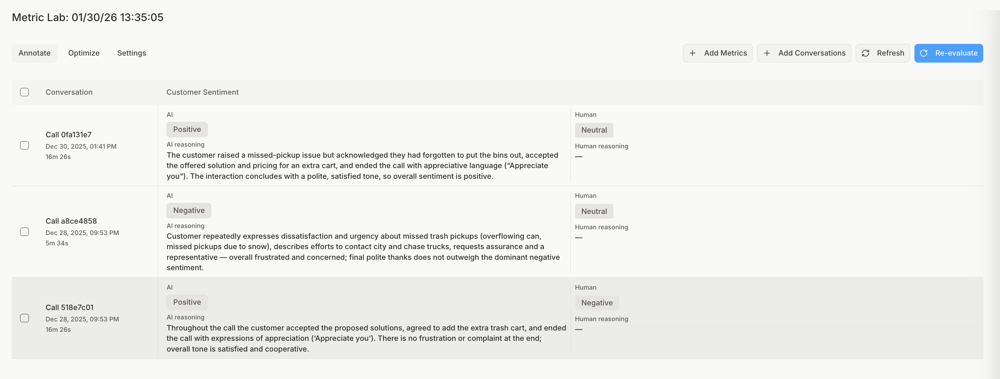
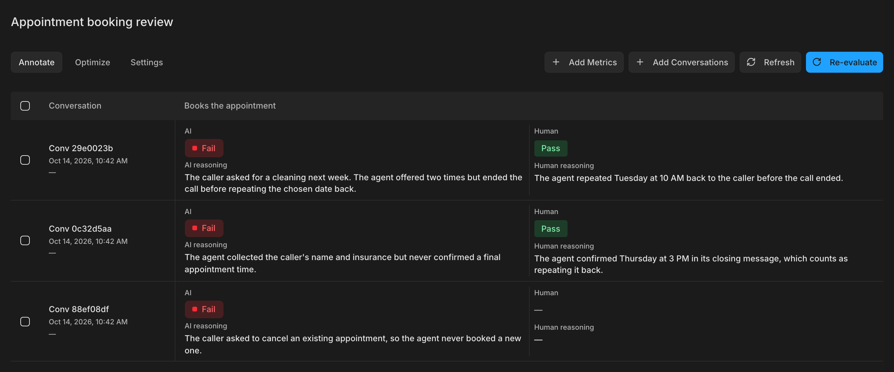

Use the metrics, alerts, and dashboards you built for AI agents to score calls that a person handled, such as a contact-center representative talking to a customer. You can also use this page to monitor human calls when you have no AI agent.

## Before you start

- Have the finished calls as recordings, transcripts, or both.
- Create an API key on the [API Keys page](https://app.getbluejay.ai/settings/api-keys) of the app.
- Ask a QA lead to label a sample of calls in step 5. Their judgment is what makes the scores trusted.

## Steps

<Steps>
  <Step title="Create an agent for the human team">
    Create one agent for each team or queue you want to measure, for example "Member Services (human agents)". Create it in the app, or with [Add Agent](/api-reference/endpoint/add-agent), which needs a `name` and a `system_prompt`.

    Use the prompt to describe the team's job and the policies its reps follow. Bluejay reads an agent's context when it [generates metrics](/monitor/metrics) for it.

    Keep human calls on their own agent. Calls on that agent stay separate from your AI agent's calls, and you can compare the two side by side later.

    Each rep on the team gets a label, so you can see every rep on their own. See [Track individual reps](#track-individual-reps).
  </Step>
  <Step title="Send the calls">
    Send each call to [`POST /v1/evaluate`](/api-reference/endpoint/evaluate) after it ends, with a `recording_url`, a `transcript`, or both. The rep is the `AGENT` and the customer is the `USER`, the same as for an AI agent. To send calls from the Logs page instead, use **Upload**.

    ```bash
    curl --request POST \
      --url https://api.getbluejay.ai/v1/evaluate \
      --header "X-API-Key: $BLUEJAY_API_KEY" \
      --header "Content-Type: application/json" \
      --data '{
        "agent_id": "123",
        "recording_url": "https://storage.example.com/calls/8841.mp3",
        "start_time_utc": "2026-11-10T16:04:00Z",
        "participants": [
          { "role": "AGENT", "spoke_first": true },
          { "role": "USER", "spoke_first": false }
        ],
        "call_direction": "INBOUND",
        "interface": "PHONE",
        "multichannel": true,
        "label": "rep-2217",
        "tags": ["human-agent"],
        "metadata": {
          "agent_type": "human",
          "team": "member-services",
          "queue": "claims",
          "external_conversation_id": "call-8841"
        }
      }'
    ```

    In `metadata`, send ids and labels you want to slice by, not names or other personal data. Each key becomes a filter on the Logs page and a [dynamic variable](/monitor/metrics/llm-as-a-judge#dynamic-variables) that a custom metric can read. Use `agent_type` to mark the calls as human, and `external_conversation_id` to [update a call later](/monitor/logs#send-conversations-with-the-api). Each evaluation is billed, and the API allows 100 requests per minute for each organization.

    **Single-channel and multichannel recordings**

    Set `multichannel` to `true` only when the rep and the customer are on separate audio channels. Bluejay then transcribes each channel on its own, so every line goes to the right person. If you set it for a file that has one channel, Bluejay treats the file as single channel.

    Without separate channels, Bluejay tells the two voices apart from the audio alone, and it can label the rep as the customer. Set `spoke_first` on the participant who talks first, because Bluejay uses it when it separates voices on a single-channel recording. On an outbound call the customer often speaks first. If your phone system can record each side on its own channel, turn that on.

    On the Logs page, **Upload** has an **Audio Channel** setting for this. It treats the rep as the first speaker and every call as inbound, and it has no fields for metadata or tags. Use the API for outbound calls or when you need either.
  </Step>
  <Step title="Pick the built-in metrics that fit people">
    Open the **Metrics** page to see the metrics on your agent. Add more from the **Library** tab.

    These describe a conversation, so they apply to a rep as they do to an AI agent:

    | Metric | What it tells you |
    |---|---|
    | **Duration** | How long the call ran. |
    | **Turn Count** | How many times the speakers took turns. |
    | **Agent Speaking %** | The share of the call where the rep talks, a talk ratio. |
    | **Avg Agent WPM** | How fast the rep speaks. |
    | **Predicted Sentiment** | How the customer sounded, from the customer's lines. |
    | **Agent Longest Dead Air (s)** | The longest silence of 5 seconds or more that the rep owes, quiet on both sides. Hold music keeps a gap from counting. |
    | **Agent Audio Clarity** | How clear the rep's audio is, from 0 to 100. |

    Read these with care, because they were built for AI agents:

    - **Agent Latency** and its percentile versions measure the pause before the agent answers. For a person, that is a normal pause, so do not use it as a target.
    - **Hallucination** checks what the agent says against its Knowledge Bases. It only means something if you attached one to the human agent.
    - **Tool Call** and **Trace** metrics need `tool_calls` or a trace in the request. A human call usually has neither.

    Predicted Sentiment and Agent Speaking % depend on correct speaker labels. On single-channel calls, spot-check them before you trust them.
  </Step>
  <Step title="Write the QA scorecard as custom metrics">
    A QA scorecard is a set of [custom metrics](/monitor/metrics), one for each behavior you check. On the **Metrics** page, click **Create**, then **Create manually**. Use the **LLM as a Judge** type with the **Pass/Fail** response type. In **Agents**, select the human agent, and set **Runs on** to include production conversations.

    Follow the [Prompting Guide](/monitor/metrics/llm-as-a-judge#prompting-guide). For human calls, add these rules to the top of every prompt:

    ```
    Judge only the conversation between the representative and the customer.
    Ignore talk before the customer is connected, after the call ends, and
    any side conversation that is not addressed to the customer.
    The representative is the person who works for the company and answers
    the customer's request. Do not assume the representative is an AI.
    ```

    The rule about side talk matters on open microphones, which record the room before and after the call. The last rule keeps a prompt written for an AI agent from scoring a person unfairly. Write every prompt this way, so one metric can score both a person and an AI agent.

    Here are six prompts to start from.

    <Tabs>
      <Tab title="Greeting">
        ```
        The metric passes if the representative greets the customer and names
        the company or team in the first 15 seconds of the conversation.

        The metric fails if the greeting has no company or team name, or if
        the customer speaks first and the representative never greets them.
        ```
      </Tab>
      <Tab title="Identity verification">
        ```
        The metric passes if the representative confirms at least two of: full
        name, date of birth, member ID, or address, BEFORE the representative
        shares any protected account or health information.

        The metric fails if the representative shares protected information
        first, or confirms fewer than two items.

        If the call never reaches protected information, the metric passes.
        ```
      </Tab>
      <Tab title="Required disclosure">
        ```
        The metric passes if the representative tells the customer that the
        call may be recorded, in the first minute of the conversation.

        The metric fails if the representative never says it, or says it
        after the first minute.
        ```

        For a disclosure that must be said word for word, use a [Phrase Match](/monitor/metrics/deterministic) metric.
      </Tab>
      <Tab title="Empathy">
        ```
        The metric passes if the customer expresses frustration, worry, or
        distress and the representative acknowledges it in a calm, warm tone
        before moving to the solution.

        The metric fails if the representative ignores the feeling, sounds
        dismissive, or talks over the customer.

        If the customer never expresses a feeling, the metric passes.
        ```

        Set the **Modality** of this metric to **Audio**, because tone is something a judge hears and a transcript does not show.
      </Tab>
      <Tab title="Hold and transfer">
        ```
        The metric passes if, before every hold or transfer, the representative
        tells the customer why and roughly how long, and after a hold thanks
        the customer for waiting. For a transfer, the representative also
        names where the customer is going.

        The metric fails if the representative puts the customer on hold or
        transfers the call without saying so.
        ```

        Turn on **Allow N/A Responses** for this metric, so a call with no hold or transfer does not pass or fail.
      </Tab>
      <Tab title="Resolution and wrap-up">
        ```
        The metric passes if the representative either resolves the customer's
        request or tells the customer the next step, who owns it, and when it
        will happen, and then asks whether the customer needs anything else.

        The metric fails if the call ends with the request open and no next
        step, or without the final check.
        ```
      </Tab>
    </Tabs>

    **Choose the modality**

    Each custom metric has a **Modality** setting of **Auto**, **Text**, or **Audio**. A **Text** metric judges the transcript. An **Audio** metric listens to the recording instead, so it does not depend on the transcript's speaker labels. It still receives the call's metadata. With **Auto**, Bluejay decides from the metric's name and description whether it needs audio.

    Prefer **Audio** for tone, and for any metric on single-channel calls, where the transcript's labels can be wrong. An **Audio** metric needs the recording. On a call sent with only a transcript, Bluejay judges it on the transcript.
  </Step>
  <Step title="Calibrate the metrics in Metrics Lab">
    On the Logs page, filter to the human agent and select 20 to 50 calls. Include clear passes, clear fails, single-channel calls, and calls with side talk. Use the **Metrics Lab** option to put them in a new lab.

    Ask your QA leads to set the **Human** verdict on every call and write a short reason on the borderline ones. Then tune each prompt until the alignment score is high, and publish it. The full workflow is in [Improve the Accuracy of a Metric](/cookbook/improve-metric-accuracy).

    
    
  </Step>
  <Step title="Compare human and AI on one scale">
    To compare people with an AI agent, attach the same published metric to both agents. Then follow these rules so the numbers mean the same thing:

    - Keep each group of calls clean. Never put human-handled and AI-handled calls on one agent.
    - Give a call that the AI handed to a human its own agent, such as "Member Services (AI handoff)", so it does not blur either group.
    - Compare the same queue and the same dates. Send the same `queue` key in `metadata` for both agents, and filter both on that key and one date range in Logs.
    - Use the same prompt, which is why the prompt does not assume who the agent is.
  </Step>
  <Step title="Watch the metrics in production">
    The rest works as it does for an AI agent:

    - Create an [alert](/monitor/alerts) on a QA metric, scoped to the human agent, to learn when a failure repeats.
    - Open [Issues](/monitor/issues) to see the most common failures in production calls.
    - Chart the metrics by agent on a [dashboard](/monitor/dashboards), so human and AI results sit side by side.
  </Step>
</Steps>

## Track individual reps

Every call can carry a **label**, and a label is how Bluejay tracks a rep. Send the rep's id as the `label` on each call. Bluejay then shows that rep on the Logs page, on dashboards, and in the API, next to the rest of the team.

One agent holds the whole team, and each rep is a label on it. This works for a team of ten reps and for a contact center with thousands.

### Send the rep as the label

Add `label` to each call you send to [`POST /v1/evaluate`](/api-reference/endpoint/evaluate). Use the rep's id from your phone system, not a name.

```json
{
  "agent_id": "123",
  "label": "rep-2217",
  "recording_url": "https://storage.example.com/calls/8841.mp3"
}
```

You do not create reps first. The first call with a new label creates it, so a new hire appears in Bluejay with their first call. The team's metrics run on every rep's calls with no extra setup.

### See each rep

<Steps>
  <Step title="Filter Logs by rep">
    The Logs page has a **Label** column that shows the rep on every call. Add a filter on **Label** and pick a rep to see only their calls. To keep the filter, save it as a **View**, for example "Rep 2217, last 7 days".
  </Step>
  <Step title="Compare reps on a dashboard">
    In a [dashboard](/monitor/dashboards) widget, set **Group By** to **Labels** to draw one bar or series for each rep. Use it to rank reps on a QA metric or to compare handle time. To show one rep, set the label filter at the top of the dashboard.
  </Step>
  <Step title="Pull a rep's calls with the API">
    [`GET /v1/observability/conversations`](/api-reference/endpoint/list-conversations) filters by label and can count conversations for each label with `group_by=label`.

    ```bash
    curl --get https://api.getbluejay.ai/v1/observability/conversations \
      --header "X-API-Key: $BLUEJAY_API_KEY" \
      --data-urlencode "agent_ids=123" \
      --data-urlencode "label=rep-2217" \
      --data-urlencode "last=30days"
    ```
  </Step>
</Steps>

### Good to know

- A call has one label. Put anything else you want to slice by, such as the queue or the site, in `metadata`.
- A label belongs to one agent. A rep who works on two teams has a label on each team's agent.
- An [alert](/monitor/alerts) watches the whole team's agent. To find the rep behind an alert, filter the Logs page by label.

## Check the result

Send three calls, then open them on the Logs page. Check that each call shows under the human agent, that the lines belong to the right speaker, and that each metric returned a result. If the speakers are swapped on a single-channel call, set `spoke_first` correctly or ask for a recording with one channel per person.

## Related

- [Logs](/monitor/logs)
- [Evaluate API](/api-reference/endpoint/evaluate)
- [Metrics](/monitor/metrics)
- [Metrics Lab](/monitor/metrics/metrics-lab)
- [Improve the Accuracy of a Metric](/cookbook/improve-metric-accuracy)
- [Alerts](/monitor/alerts)
- [Dashboards](/monitor/dashboards)
