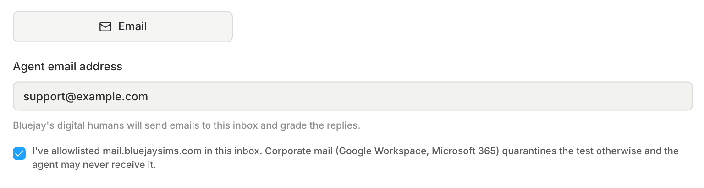
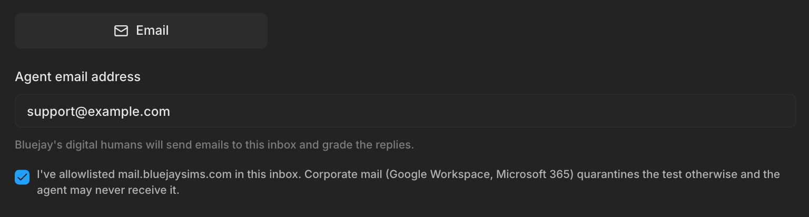

Connect an email agent, let Bluejay's test mail into its inbox, and grade whether your agent's replies pass authentication and arrive.




## Connect

<Tabs>
<Tab title="Website">
<Steps>
<Step title="Create the agent">
Create an agent with the **Email** mode. Choose **Inbound** if customers write to your agent first, or **Outbound** if your agent writes first. Set up the allowlist for `mail.bluejaysims.com` first, as in [Allow Bluejay's mail](#allow-bluejays-mail), or the agent may never receive the test.

If your agent answers from addresses other than its inbox, add them later under **Reply-from addresses** in the agent's connection settings. Bluejay ignores a reply from any other address.
</Step>
<Step title="Run a simulation">
Add the agent to a [simulation](/test/simulations/create) and run it. For an **Outbound** agent, send the first email from your own system, as in [How a conversation runs](#how-a-conversation-runs).
</Step>
</Steps>
</Tab>
<Tab title="API">

```bash
curl -X POST https://api.getbluejay.ai/v1/add-agent \
  -H "X-API-Key: $BLUEJAY_API_KEY" \
  -H "Content-Type: application/json" \
  -d '{
    "name": "Support Inbox",
    "type": "INBOUND",
    "connection_type": "EMAIL",
    "email_address": "support@yourcompany.com",
    "email_reply_addresses": ["help@yourcompany.com"]
  }'
```

Bluejay sets the agent's `mode` to `EMAIL` itself. `email_reply_addresses` is optional. Queue runs with `/v1/queue-email-simulation-run` and the `simulation_id`.
</Tab>
</Tabs>

<Tabs>
<Tab title="Test">

## Allow Bluejay's mail

Corporate mail services such as Google Workspace and Microsoft 365 quarantine mail from unknown senders. If the agent's inbox does not allowlist `mail.bluejaysims.com`, the agent never receives the test and every check fails.

### Google Workspace

1. In the Admin console, open **Apps > Google Workspace > Gmail > Spam, phishing, and malware**.
2. Under **Email allowlist**, add a rule that bypasses spam for `mail.bluejaysims.com`, and save.

### Microsoft 365

1. In Microsoft 365 Defender, open **Policies & rules > Threat policies > Anti-spam**.
2. Add `mail.bluejaysims.com` to the allowed domains, or add a mail flow rule that bypasses spam filtering for that domain, and save.

If a test email does not arrive, look in the admin quarantine first.

<Video src="/videos/email-run-sim.mp4" title="email-run-sim.mp4" />

## How a conversation runs

Every Digital Human has its own address on `mail.bluejaysims.com`, which stays the same across runs, and your agent replies to that address. The agent type sets who writes first:

- **Inbound**: the Digital Human writes the first email to the agent email address.
- **Outbound**: your agent writes first. Each Digital Human waits for an email at its own address, then replies. Bluejay does not call an outbound trigger webhook for an email agent, even if one is set, so send the first email from your own system. Each Digital Human's address is on its **Connection** tab.

After that, the two sides take turns in one email thread. Bluejay reads only the new text of each reply and drops the quoted history below it.

To count, a reply must come from the agent email address or one of the reply-from addresses, and it must pass authentication. Bluejay accepts a reply that passes DMARC. If your domain publishes no DMARC policy, Bluejay accepts a reply that has a DKIM signature from the sender's domain instead.

Bluejay ignores any other mail. If a reply comes from an address on your own domain that the agent does not list, the conversation also shows <Code>EMAIL&#95;SENDER&#95;MISMATCH</Code>, so you know which address to add. The conversation stays open, and a later reply from a listed address still counts.

### How a conversation ends

Bluejay does not read an end signal from your agent's email. A conversation ends when one of these happens:

- The Digital Human ends it.
- The thread reaches the simulation's maximum number of turns, 100 messages from both sides by default.
- No email arrives for the inactivity timeout, 30 minutes by default. If the simulation sets its own inactivity timeout, Bluejay uses that value, between 5 and 30 minutes.
- In an uptime check, the agent sends its first reply.

## Metrics

Bluejay grades the mail itself with built-in metrics, such as **SPF Pass Rate** and **DKIM Pass Rate** on your agent's reply. Three of them need a note:

- **Spam Score**: lower is better.
- **Delivered Rate**: checks the Digital Human's email, not your agent's reply. It passes when the email reached your agent's inbox without a hard bounce or a spam complaint.
- **DMARC Pass Rate**: a domain with no DMARC policy fails this metric, even though Bluejay still accepts its reply.

For an **Inbound** agent, Bluejay also records the time from the Digital Human's first email to your agent's first reply as the agent's latency.

<Video src="/videos/email-metrics.mp4" title="email-metrics.mp4" />

### What the email checks mean

Mail servers run these checks to decide whether an email really comes from the domain it claims, and whether it goes to the inbox or to spam. A failed check is a common reason a reply never reaches the customer.

- **SPF** (Sender Policy Framework) checks whether the server that sent the email is allowed to send for the sender's domain. The domain lists its allowed servers in its DNS, the public records that describe a domain.
- **DKIM** (DomainKeys Identified Mail) checks the email's digital signature. The sending domain signs each email with a private key and publishes the matching public key in its DNS. A valid signature proves that whoever holds the domain's key signed the email, and that the signed parts, usually the body and key headers, did not change on the way. An unsigned email fails.
- **DMARC** (Domain-based Message Authentication, Reporting and Conformance) checks that the domain in the **From** address matches a domain that passed SPF or DKIM. The match can be the same domain or a subdomain of it, and it is called alignment. The domain must also publish a DMARC policy, a DNS record that tells receivers what to do with mail that fails. Bluejay counts a domain with no DMARC policy as a fail, even when SPF and DKIM pass.
- **Spam** is a spam score that a receiving mail server added to the email. Lower is better. Each server sets its own threshold. With SpamAssassin, the most common scorer, 5 or more usually means spam.
- **N/A** means there was nothing to judge, for example because the email carries no verdict from a receiving server.

In a simulation, Bluejay's own mail server receives your agent's replies, so it records SPF, DKIM, and DMARC verdicts for every reply. To run the same checks on your production threads, see [Logs](/monitor/logs#email).

</Tab>
<Tab title="Monitor">

To check an email agent on a schedule, use [Uptime Monitoring](/monitor/uptime/overview). In the app, an uptime monitor or a scheduled run for an email agent runs at most every 30 minutes. If the Digital Human's email hard bounces or gets a spam complaint, Bluejay pauses the monitor so that it stops sending to an inbox that rejects its mail.

<Video src="/videos/email-uptime.mp4" title="email-uptime.mp4" />

</Tab>
</Tabs>

## Limits

- Email runs take longer than voice or SMS runs.
- A Digital Human can be in only one open email conversation at a time, because Bluejay matches your agent's replies to the Digital Human by its address. In a run, each Digital Human's conversations take turns, and it runs once even if the simulation sets more runs per Digital Human.

## Troubleshooting

| What you see | What to do |
|---|---|
| `400`: `EMAIL connection_type requires email_address` | Set <Code>email&#95;address</Code> when <Code>connection&#95;type</Code> is `EMAIL`. |
| `400`: `email_reply_addresses: '...' is not an email address` | Fix the entry in <Code>email&#95;reply&#95;addresses</Code> that is not an email address. |
| `400`: `Agent is not an email agent (mode EMAIL, email_address set)` | Queue <Code>/v1/queue-email-simulation-run</Code> only for a simulation whose agent is an email agent. |
| `409`: <Code>EMAIL&#95;DIGITAL&#95;HUMAN&#95;CONFLICT</Code> | A Digital Human in the run is already in an open email conversation. Wait for it to finish, then run again. |
| <Code>EMAIL&#95;SENDER&#95;MISMATCH</Code> | Your agent replied from an address on your domain that the agent does not list. Add it to **Reply-from addresses**. |
| **System Error** with <Code>END&#95;SIGNAL&#95;TIMEOUT</Code> | An Outbound agent sent no email before the inactivity timeout. Send the first email from your system to the Digital Human's address. |
| The transcript has only the Digital Human's first email | No reply reached Bluejay. Look in the admin quarantine, and check that the agent replies from a listed address that passes authentication. |

## Related

- [Agents API](/api-reference/endpoint/add-agent)
- [Phone Number](/integrations/phone-number)
- [SMS](/integrations/sms)
- [Simulation](/test/simulations/create)
- [Digital Human Reference](/test/simulations/digital-humans)
- [Uptime Monitoring](/monitor/uptime/overview)
