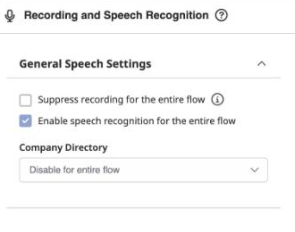
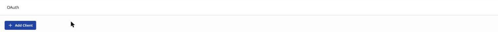
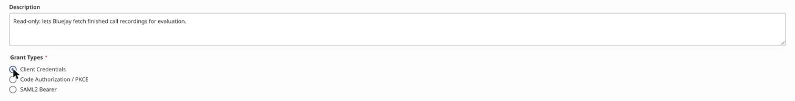
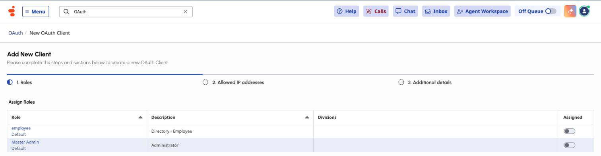
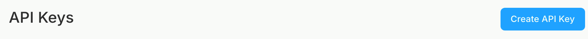
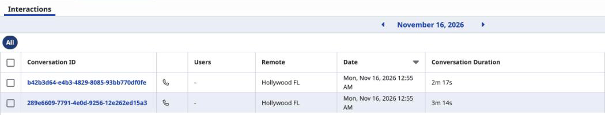
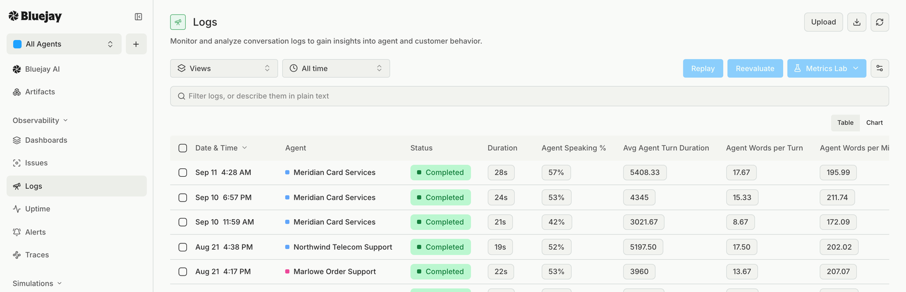
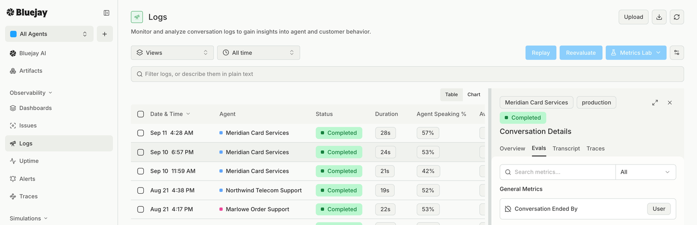

Use this page to get your production calls from Genesys Cloud into Bluejay Logs, so metrics, alerts, issues, and dashboards cover them.

<Note>Bluejay has no built-in Genesys Cloud connector. You run a small job that reads finished calls from Genesys Cloud and sends each one to Bluejay with [`POST /v1/evaluate`](/api-reference/endpoint/evaluate).</Note>

## How it works

For every finished call, your job does three things:

1. **Find.** Ask Genesys Cloud which calls finished in a time window.
2. **Fetch.** Ask Genesys Cloud for each call's recording link.
3. **Send.** Post the link to Bluejay. Bluejay downloads the audio, transcribes it, and runs your metrics.

The call then appears in [Logs](/monitor/logs) with its transcript and metric results. The [script](#the-script) at the end of this page does all three.

## Before you start

- A Genesys Cloud admin who can create an OAuth client and edit Architect flows.
- A Bluejay agent to file the calls under. Use one agent for each line or queue you want to track separately. To tell individual reps apart, see [Track individual reps](/cookbook/evaluate-human-agents#track-individual-reps).
- Somewhere to run a scheduled job, such as cron or a serverless function.

## Steps

<Steps>
  <Step title="Make sure Genesys Cloud records the calls">
    Bluejay scores the audio, so each call needs a real recording. Turn on recording for the external trunk the calls arrive on.

    If an Architect flow handles the call, such as an IVR or a virtual agent, open the flow. Go to **Settings > Recording and Speech Recognition** and clear **Suppress recording for the entire flow**. Then publish the flow.

    

    If that box is ticked, Genesys Cloud still lists a recording for the call. In our test it was about half a second long and had no download link. A new call after clearing the box and publishing returned a recording of the full call.

    If your trunk can record each side on its own channel, turn that on. The external trunk has the properties `trunk_recording_enabled` and `trunk_recording_dualChannel`.
  </Step>
  <Step title="Create an OAuth client in Genesys Cloud">
    The client gives your job read access to conversations and recordings.

    Search for **OAuth** and open **IT and Integrations > OAuth**. Click **Add Client**.

    

    Enter an app name and a description, and choose the **Client Credentials** grant type. Click **Next**.

    

    On the **Roles** step, assign a role that can view conversation details and recordings, and choose the divisions your calls are in. The job uses two permissions, `analytics:conversationDetail:view` and `recording:recording:view`. A dedicated read-only role with only these is best. If a request returns `403`, the error names the permission the role lacks.

    

    Finish the steps **2. Allowed IP addresses** and **3. Additional details**, then save. Copy the **Client ID** and **Client Secret** into your secrets manager.
  </Step>
  <Step title="Create a Bluejay API key and find your agent ID">
    In Bluejay, open **Settings > API Keys** and click **Create API Key**. Copy the key into your secrets manager.

    

    Open the agent the calls belong to and note its ID. If you set an `external_agent_id` on the agent, you can send that instead of `agent_id`.
  </Step>
  <Step title="Find the calls that finished">
    Get a token with your OAuth client, then query the voice conversations in your time window. Each conversation has a `conversationId`, the same ID the **Interactions** page shows.

    ```text
    POST https://login.{region}/oauth/token
    Authorization: Basic base64(client_id:client_secret)
    Content-Type: application/x-www-form-urlencoded

    grant_type=client_credentials
    ```

    ```text
    POST https://api.{region}/api/v2/analytics/conversations/details/query
    {
      "interval": "2026-11-16T00:00:00Z/2026-11-17T00:00:00Z",
      "order": "asc",
      "orderBy": "conversationStart",
      "paging": {"pageSize": 100, "pageNumber": 1},
      "segmentFilters": [{"type": "and",
        "predicates": [{"dimension": "mediaType", "value": "voice"}]}]
    }
    ```

    

    Each conversation in the response has `conversationId`, `conversationStart`, and `conversationEnd`. Its participants have sessions that include the caller's `ani`. Send only calls that have a `conversationEnd`.

    Use short windows, such as one day or less. In our test, an interval longer than about a month returned nothing.
  </Step>
  <Step title="Get each call's recording link">
    ```text
    GET https://api.{region}/api/v2/conversations/{conversationId}/recordings?formatId=WAV&maxWaitMs=5000

    200  [{"id": "...", "fileState": "AVAILABLE",
           "mediaUris": {"0": {"mediaUri": "https://api-downloads.{region}/..."}}}]
    202  the recording is still being prepared, ask again in a few seconds
    404  the call is still in progress
    ```

    The `mediaUri` is a signed link. It carries its own access in the `Expires`, `Signature`, and `Key-Pair-Id` query parameters, so Bluejay needs no extra headers. It expires, so send it to Bluejay right away and do not store it.

    An empty `mediaUris` can mean that recording is suppressed. Check step 1.
  </Step>
  <Step title="Send the call to Bluejay">
    ```bash
    curl https://api.getbluejay.ai/v1/evaluate \
      -H "X-API-Key: $BLUEJAY_API_KEY" \
      -H "Content-Type: application/json" \
      -d '{
        "agent_id": "<your Bluejay agent id>",
        "recording_url": "<mediaUri from Genesys Cloud>",
        "start_time_utc": "2026-11-16T05:55:47Z",
        "call_direction": "INBOUND",
        "interface": "PHONE",
        "participants": [
          {"role": "AGENT", "spoke_first": true},
          {"role": "USER", "phone_number": "+15555550123"}
        ],
        "metadata": {
          "external_conversation_id": "<Genesys conversationId>",
          "source": "genesys"
        }
      }'
    ```

    | Field | What to send |
    |---|---|
    | `recording_url` | The `mediaUri` from step 5. Bluejay downloads and transcribes it. |
    | `start_time_utc` | The conversation's `conversationStart`. |
    | `participants` | Exactly two: one `AGENT` and one `USER`. Set `spoke_first` on whoever speaks first. |
    | `metadata.external_conversation_id` | The Genesys Cloud `conversationId`. Sending the same id again replaces that conversation. |
    | `label` | The id of the rep who took the call, for a human-handled call. Bluejay tracks each rep by label. See [Track individual reps](/cookbook/evaluate-human-agents#track-individual-reps). |
    | `metadata`, other keys | Queue, language, and other values you want to filter by. They also work as [dynamic variables](/monitor/metrics/llm-as-a-judge#dynamic-variables) in custom metrics. |
    | `multichannel` | `true` if the trunk records the caller and the agent on separate channels. |

    A successful response includes a `call_id`. The API allows 100 requests per minute for each organization, or 500 for enterprise accounts.

    Each request that changes a conversation is evaluated and billed. Bluejay ignores a repeat only when the transcript, transcript link, and recording link are all the same, and a signed link from Genesys Cloud can differ from one request to the next. Use windows that do not overlap, so each call is sent once. See the [Logs](/monitor/logs#send-conversations-with-the-api) page for how repeats work.
  </Step>
  <Step title="Check the call in Bluejay">
    Open **Logs**. The call appears as a new row under your agent after Bluejay processes the audio. Open it to read the transcript and see each metric's result.

    
    
  </Step>
</Steps>

## The script

This Python script does steps 4 to 6 for one time window. It uses only the standard library. It reads one page of up to 100 calls, so use windows that hold fewer calls than that.

<Warning>This script is an example, not a supported tool. It has not been run end to end against a Genesys Cloud OAuth client. Run it on a few test calls first.</Warning>

Run it on a schedule, such as every 15 minutes over the 15 minutes that just ended, with no overlap between runs.

```bash
export GENESYS_REGION=usw2.pure.cloud
export GENESYS_CLIENT_ID=...
export GENESYS_CLIENT_SECRET=...
export BLUEJAY_API_KEY=...
export BLUEJAY_AGENT_ID=...

python genesys_to_bluejay.py 2026-11-16T00:00:00Z/2026-11-17T00:00:00Z
```

<Accordion title="genesys_to_bluejay.py">
```python
"""Send finished Genesys Cloud calls to Bluejay.

For each voice conversation in the time window: fetch its recording from Genesys Cloud,
then post the call to Bluejay's /v1/evaluate. Bluejay downloads the recording, transcribes
it, and runs your metrics. The Genesys conversationId is sent as external_conversation_id.

Environment:
  GENESYS_REGION         e.g. usw2.pure.cloud, mypurecloud.com
  GENESYS_CLIENT_ID      OAuth client (Client Credentials grant) with recording view access
  GENESYS_CLIENT_SECRET
  BLUEJAY_API_KEY
  BLUEJAY_AGENT_ID       the Bluejay agent these calls belong to
Usage:
  python genesys_to_bluejay.py 2026-11-16T00:00:00Z/2026-11-17T00:00:00Z
"""
import base64, json, os, sys, time, urllib.error, urllib.parse, urllib.request

REGION = os.environ["GENESYS_REGION"]
GENESYS_API = f"https://api.{REGION}"
BLUEJAY_API = "https://api.getbluejay.ai"


def http(method, url, headers, body=None, form=None):
    data = urllib.parse.urlencode(form).encode() if form else (json.dumps(body).encode() if body is not None else None)
    req = urllib.request.Request(url, data=data, method=method, headers=headers)
    try:
        with urllib.request.urlopen(req, timeout=120) as r:
            raw = r.read()
            return r.status, (json.loads(raw) if raw else None)
    except urllib.error.HTTPError as e:
        return e.code, e.read().decode()[:300]


def genesys_token():
    basic = base64.b64encode(f"{os.environ['GENESYS_CLIENT_ID']}:{os.environ['GENESYS_CLIENT_SECRET']}".encode()).decode()
    status, body = http("POST", f"https://login.{REGION}/oauth/token",
                        {"Authorization": f"Basic {basic}", "Content-Type": "application/x-www-form-urlencoded"},
                        form={"grant_type": "client_credentials"})
    if status != 200:
        sys.exit(f"Genesys token request failed: {status} {body}")
    return body["access_token"]


def finished_calls(auth, interval):
    status, body = http("POST", f"{GENESYS_API}/api/v2/analytics/conversations/details/query",
                        {**auth, "Content-Type": "application/json"},
                        body={"interval": interval, "order": "asc", "orderBy": "conversationStart",
                              "paging": {"pageSize": 100, "pageNumber": 1},
                              "segmentFilters": [{"type": "and", "predicates": [{"dimension": "mediaType", "value": "voice"}]}]})
    if status != 200:
        sys.exit(f"Genesys conversation query failed: {status} {body}")
    return [c for c in (body.get("conversations") or []) if c.get("conversationEnd")]


def recording_url(auth, conversation_id):
    for _ in range(12):
        status, body = http("GET", f"{GENESYS_API}/api/v2/conversations/{conversation_id}/recordings?formatId=WAV&maxWaitMs=5000", auth)
        if status == 200 and body:
            ready = [r for r in body if r.get("mediaUris")]
            if ready:
                longest = max(ready, key=lambda r: r["endTime"])
                return next(iter(longest["mediaUris"].values()))["mediaUri"]
        if status not in (200, 202):
            return None
        time.sleep(5)
    return None


def caller_number(conversation):
    for p in conversation.get("participants", []):
        if p.get("purpose") in ("customer", "external"):
            for s in p.get("sessions", []):
                if s.get("ani"):
                    return s["ani"].replace("tel:", "")
    return None


def main():
    interval = sys.argv[1]
    auth = {"Authorization": f"Bearer {genesys_token()}"}
    calls = finished_calls(auth, interval)
    print(f"Genesys: {len(calls)} finished voice calls in {interval}")
    for c in calls:
        cid = c["conversationId"]
        url = recording_url(auth, cid)
        if not url:
            print(f"  {cid}  no recording, skipped")
            continue
        status, body = http("POST", f"{BLUEJAY_API}/v1/evaluate",
                            {"X-API-Key": os.environ["BLUEJAY_API_KEY"], "Content-Type": "application/json"},
                            body={"agent_id": os.environ["BLUEJAY_AGENT_ID"],
                                  "recording_url": url,
                                  "start_time_utc": c["conversationStart"],
                                  "call_direction": "INBOUND",
                                  "interface": "PHONE",
                                  "participants": [{"role": "AGENT", "spoke_first": True},
                                                   {"role": "USER", "phone_number": caller_number(c)}],
                                  "metadata": {"external_conversation_id": cid, "source": "genesys"}})
        print(f"  {cid}  -> Bluejay {status} {body.get('call_id') if isinstance(body, dict) else body}")


if __name__ == "__main__":
    main()
```
</Accordion>

## Good to know

- **Region.** Use your own Genesys Cloud region in the hostnames, such as `mypurecloud.com` or `usw2.pure.cloud`.
- **Recordings take a moment.** Right after a call ends, the recordings request can return `202`. The script waits and asks again.
- **More than 100 calls in a window.** Raise `pageNumber` until Genesys Cloud returns no more conversations, or use shorter windows.
- **Skipped calls.** The script waits about a minute for a recording link. If none arrives, it skips the call and does not try it again in a later window. Run the script again for that window, or send the call yourself.

## Related

- [Logs](/monitor/logs)
- [Evaluate API](/api-reference/endpoint/evaluate)
- [Evaluate Human Agent Calls](/cookbook/evaluate-human-agents)
- [Connect Your Agent](/integrations/overview)
