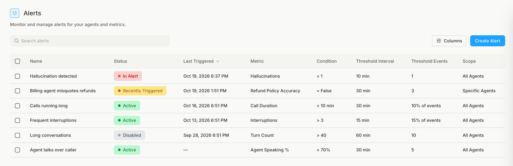
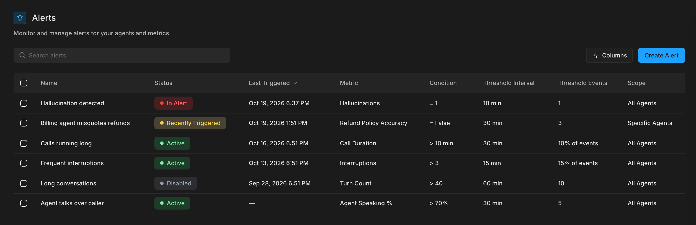
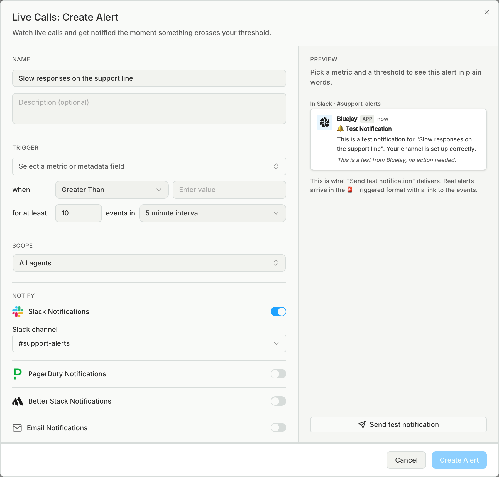
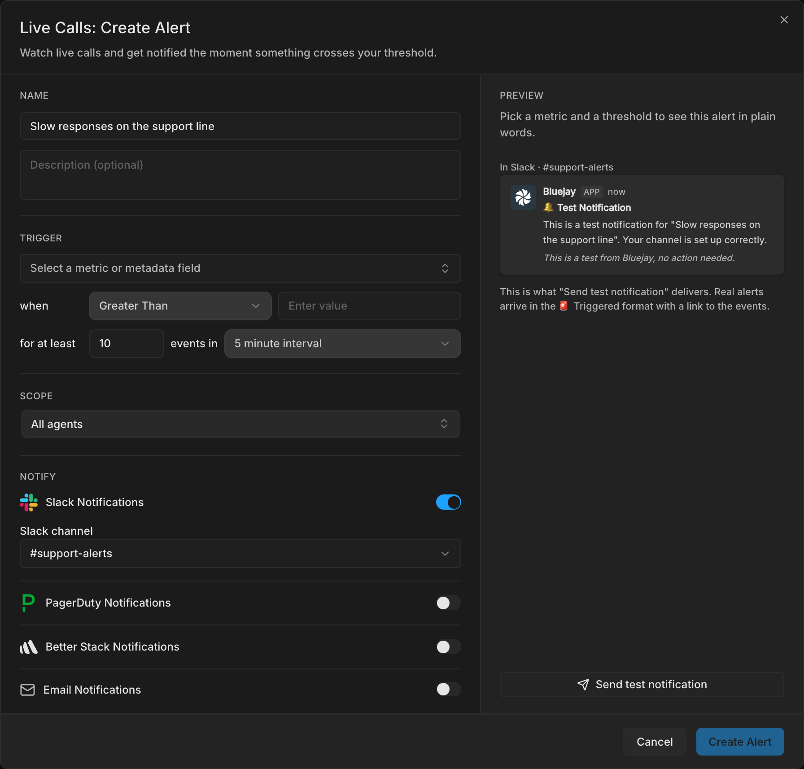

Use an alert with a [metric](/monitor/metrics) to catch failures on your production conversations.

To create alerts from code, use the [Alerts API](/api-reference/endpoint/create-alert).

## Connect a channel

<Tabs>
<Tab title="Slack">
1. In Bluejay, open **Settings → Integrations** and choose the **Slack** tab. Connect Slack there.
2. In each alert, pick the Slack channel it posts to.
</Tab>
<Tab title="PagerDuty">
1. In PagerDuty, open the service that receives Bluejay incidents.
2. Under **Integrations**, add an **Events API V2** integration and copy its **Integration Key**.
3. In Bluejay, open **Settings → Integrations** and choose the **PagerDuty** tab. Paste the key into **Routing Key**.
</Tab>
<Tab title="Better Stack">
1. In Better Stack, open **API tokens**, then **Team-based tokens**.
2. Select the team whose on-call rotation receives Bluejay incidents.
3. Under **Uptime API tokens**, create a token and copy it.
4. In Bluejay, open **Settings → Integrations** and choose the **Better Stack** tab. Paste the token into **API token**. Bluejay checks the token with Better Stack when you save it.
</Tab>
<Tab title="incident.io">
1. In incident.io, open **Alerts**, then **Sources**, and create an **HTTP** source.
2. Copy the source ID from the end of its URL, `https://api.incident.io/v2/alert_events/http/<source ID>`, and copy its token.
3. Connect the source to an alert route that escalates to your on-call.
4. In Bluejay, open **Settings → Integrations** and choose the **incident.io** tab. Paste the source ID into **Alert source ID** and the token into **Token**.
</Tab>
<Tab title="Webhook">
Use a webhook to send alerts to your own endpoint or to start an automated flow.

1. In **Settings → Webhooks**, [create a webhook](/api-reference/webhooks#create-a-webhook) with your HTTPS URL and select **Observability alert triggered**.
2. Copy the signing key to your receiver so it can [verify each request](/api-reference/webhooks#verify-the-signature).

The webhook fires when an alert enters alarm and again when it leaves alarm.
</Tab>
</Tabs>

## Create an alert

<Steps>
  <Step title="Open the dialog">
    In the sidebar under **Observability**, open **Alerts** and click **Create Alert**.
  </Step>
  <Step title="Set the trigger and scope">
    For a metric where one failure is too many, such as hallucination, set **for at least** to 1.

    An alert watches only its own [workspace](/administration/workspaces), even when set to all agents, so create it in the workspace of the agents it should watch.
  </Step>
  <Step title="Choose who gets notified">
    Send failures that need action now to PagerDuty, Better Stack, or incident.io, and quality drops to Slack or email. Only [connected channels](#connect-a-channel) can be turned on.

    
    
  </Step>
</Steps>

## How alerts evaluate

An alert counts the production conversations that match its condition in the window. It enters alarm when at least N conversations match, where N is the **for at least** number, and recovers when the count drops below 80% of N (minimum 1).

With a window such as the last 50 conversations, the alert does not fire until that many conversations exist.

## Incidents

PagerDuty, Better Stack, and incident.io receive incidents, and your escalation policy in that tool decides who gets the page.

| Source | Opens an incident | Resolves the incident |
|---|---|---|
| Uptime monitor | When the monitor goes **Down** | When the monitor recovers |
| Alert | When the alert triggers | When the alert recovers |

## Related

- [Alerts API](/api-reference/endpoint/create-alert)
- [Alerts MCP tools](/mcp/monitoring-tools#monitor)
- [Webhooks](/api-reference/webhooks)
- [Uptime Monitoring](/monitor/uptime/overview)
- [Issues](/monitor/issues)
- [Dashboards](/monitor/dashboards)
