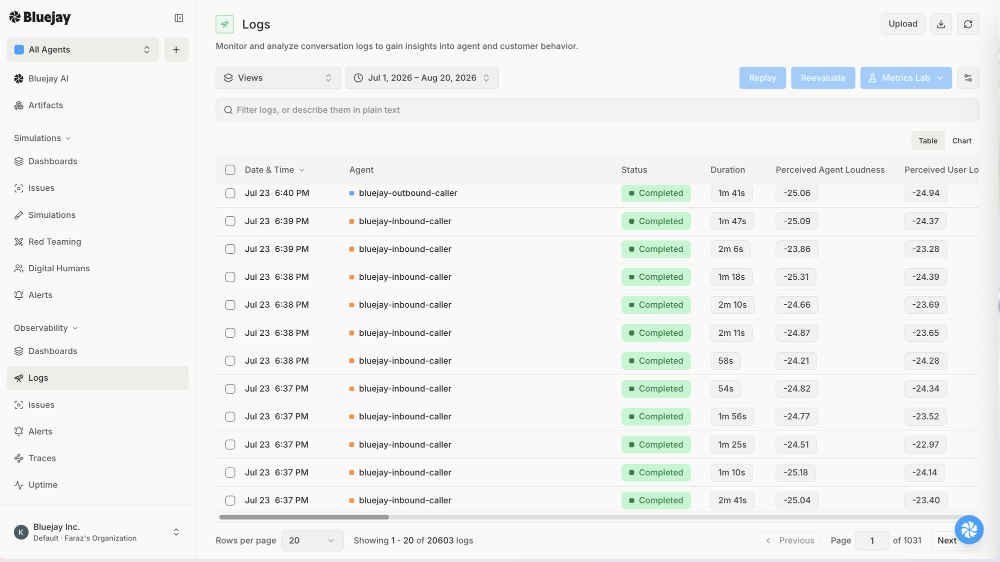
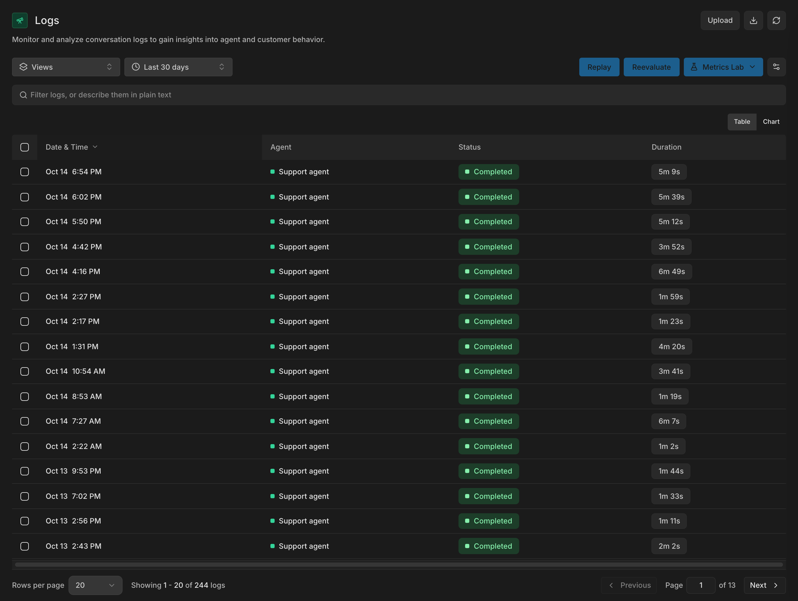

## Get conversations into Logs

Logs shows your production conversations. They can arrive from four sources:

| Source | How conversations arrive |
|--------|--------------------------|
| [SDK](/sdk/overview) | Your agent sends the call as it happens. |
| Voice platform | Each ended call arrives after you [connect the platform](/integrations/vapi#monitor). |
| [`POST /v1/evaluate`](/api-reference/endpoint/evaluate) | Your backend sends each conversation after it ends. For [Genesys Cloud](/integrations/genesys), a small job you run does this. |
| **Upload** | Upload **Audio Call** files or a **Chat/Transcript** from the Logs page. |

### Send conversations with the API

Send each conversation to `/v1/evaluate` once it has ended. To update one later, put your own id for it in `metadata` as `external_conversation_id`. A request for the same agent with the same id replaces that conversation and evaluates it again, so always send the whole conversation. If `metadata` also has a provider call id, such as `vapi_call_id`, Bluejay uses that id instead. A request identical to the last one is ignored.

<Tip>Every request that changes a conversation is evaluated and billed. Forwarding a conversation once it has ended costs the least.</Tip>

#### Voice

Send `recording_url`, a `transcript`, or both. Calls from a [connected voice platform](/integrations/vapi#monitor) arrive on their own, and the platform's call id links repeat sends to one conversation.

If the recording needs a login to download, pass the auth headers in [`recording_auth_headers`](/api-reference/endpoint/evaluate).

#### Text and SMS

Send a `transcript`. There is no audio, so latency comes from each entry's `start_offset_ms`. Send real offsets to see how long your agent takes to reply.

#### Email

Send the thread in `emails`, oldest first. Each email has a `speaker` and `raw`, the full source of the email with its headers, as **Show original** shows it in Gmail. When you leave out `transcript`, Bluejay builds it from the emails, so set `start_time_utc` to the time of the first email. It also checks each of your agent's emails for SPF, DKIM, DMARC, and spam.

<Video src="/videos/email-obs-checks.mp4" title="email-obs-checks.mp4" />

<Accordion title="What the email checks mean">
Mail servers run these checks to decide whether an email really comes from the domain it claims, and whether it goes to the inbox or to spam. A failed check is a common reason a reply never reaches the customer.

- **SPF** (Sender Policy Framework) checks whether the server that sent the email is allowed to send for the sender's domain. The domain lists its allowed servers in its DNS, the public records that describe a domain.
- **DKIM** (DomainKeys Identified Mail) checks the email's digital signature. The sending domain signs each email with a private key and publishes the matching public key in its DNS. A valid signature proves that whoever holds the domain's key signed the email, and that the signed parts, usually the body and key headers, did not change on the way. An unsigned email fails.
- **DMARC** (Domain-based Message Authentication, Reporting and Conformance) checks that the domain in the **From** address matches a domain that passed SPF or DKIM. The match can be the same domain or a subdomain of it, and it is called alignment. The domain must also publish a DMARC policy, a DNS record that tells receivers what to do with mail that fails. Bluejay counts a domain with no DMARC policy as a fail, even when SPF and DKIM pass.
- **Spam** is a spam score that a receiving mail server added to the email. Lower is better. Each server sets its own threshold. With SpamAssassin, the most common scorer, 5 or more usually means spam.
- **N/A** means there was nothing to judge, for example because the email carries no verdict from a receiving server.

SPF and spam come from a receiving mail server's headers. On a copy that no server received, both show **N/A**. Bluejay verifies DKIM itself and checks DMARC itself when no server recorded a verdict.
</Accordion>

## Find a conversation

To find the conversations worth reading, start from a failing metric or an issue, then read the transcript to see where the agent went wrong. You can also type a plain-text query in the search box, for example "failed calls yesterday". If a transcript does not explain the failure, open the linked [Traces](/monitor/traces).

## Act on conversations

You can also run these options on any selected conversations:

- **Reevaluate** runs the metrics again on up to 100 conversations at a time. If all selected conversations belong to one agent, it can use a different agent version, so you can check a fix on real conversations.
- **Replay** tests the conversations against a target agent in a [simulation](/test/simulations/create), so a real failure becomes a repeatable test.
- **Metrics Lab** puts the conversations in a new or existing [Metrics Lab](/monitor/metrics/metrics-lab). Use it when a metric verdict looks wrong on many conversations.

## Related

- [Evaluate API](/api-reference/endpoint/evaluate)
- [Monitoring MCP tools](/mcp/monitoring-tools#monitor)
- [Tool Calls, Events, and Metadata](/monitor/metrics#tool-calls-events-and-metadata)
- [Traces](/monitor/traces)
- [Issues](/monitor/issues)
- [Evaluate Human Agent Calls](/cookbook/evaluate-human-agents)
