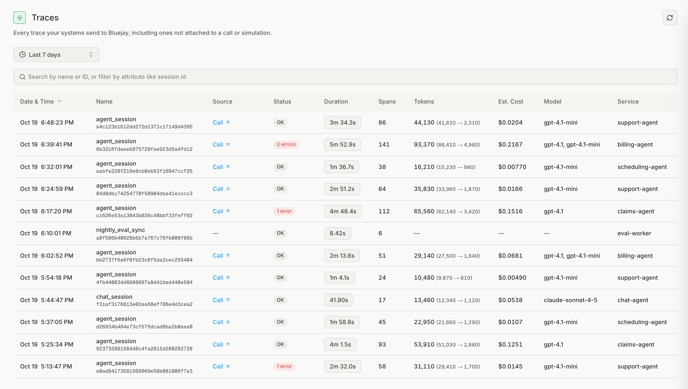
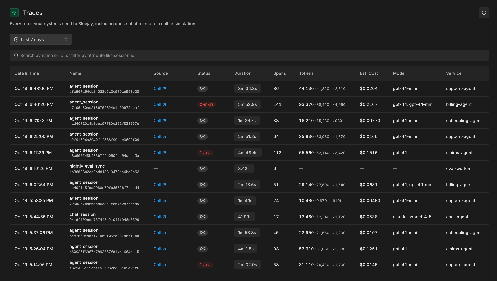

Bluejay accepts OpenTelemetry traces and shows each trace next to the production conversation that you link it to.

If you are linking traces to simulation results, see [Traces](/test/traces).




## Export traces to Bluejay

Bluejay accepts traces from any OpenTelemetry-compatible library, for example OpenInference, OpenLLMetry, or Langfuse. Using a voice framework? Its [integration page](/integrations/phone-number) can show a framework-specific setup.

<Steps>
  <Step title="Get an API key">
    Create one as described in [Get an API key](/api-reference/introduction#make-your-first-request).
  </Step>
  <Step title="Install the packages">
    ```bash
    pip install opentelemetry-sdk opentelemetry-exporter-otlp-proto-http opentelemetry-instrumentation-openai
    ```
  </Step>
  <Step title="Point the exporter at Bluejay">
    Send spans over OTLP HTTP to `https://otlp.getbluejay.ai/v1/traces`, with your API key in the `X-API-KEY` header:

    ```python
    from opentelemetry.sdk import trace as trace_sdk
    from opentelemetry.exporter.otlp.proto.http.trace_exporter import OTLPSpanExporter
    from opentelemetry.sdk.trace.export import SimpleSpanProcessor
    from opentelemetry.sdk.resources import SERVICE_NAME, Resource

    tracer_provider = trace_sdk.TracerProvider(
        resource=Resource.create({SERVICE_NAME: "<your_service_name>"})
    )
    tracer_provider.add_span_processor(SimpleSpanProcessor(OTLPSpanExporter(
        "https://otlp.getbluejay.ai/v1/traces",
        headers={"X-API-KEY": "<BLUEJAY_API_KEY>"},
    )))
    ```
  </Step>
  <Step title="Instrument your LLM client">
    For example, the OpenAI client:

    ```python
    from opentelemetry.instrumentation.openai import OpenAIInstrumentor
    OpenAIInstrumentor().instrument(tracer_provider=tracer_provider)
    ```
  </Step>
</Steps>

## Link a trace

To show a trace next to its conversation, add the conversation's `trace_id` to your [`POST /v1/evaluate`](/api-reference/endpoint/evaluate) request. The SDK links traces when you capture the conversation using a [session or a voice integration](/sdk/observability).

## Related

- [Traces API](/api-reference/endpoint/list-traces)
- [Traces MCP tools](/mcp/monitoring-tools#monitor)
- [Logs](/monitor/logs)
- [Tool Calls, Events, and Metadata](/monitor/metrics#tool-calls-events-and-metadata)
- [Trace metric](/monitor/metrics/deterministic#trace)
