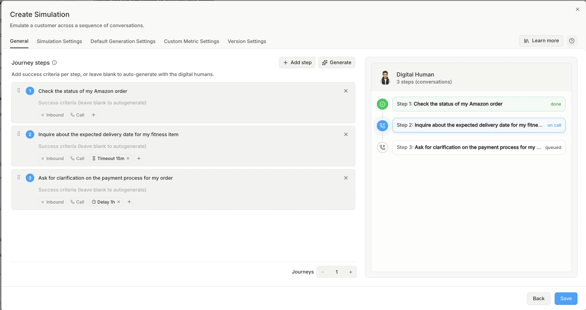
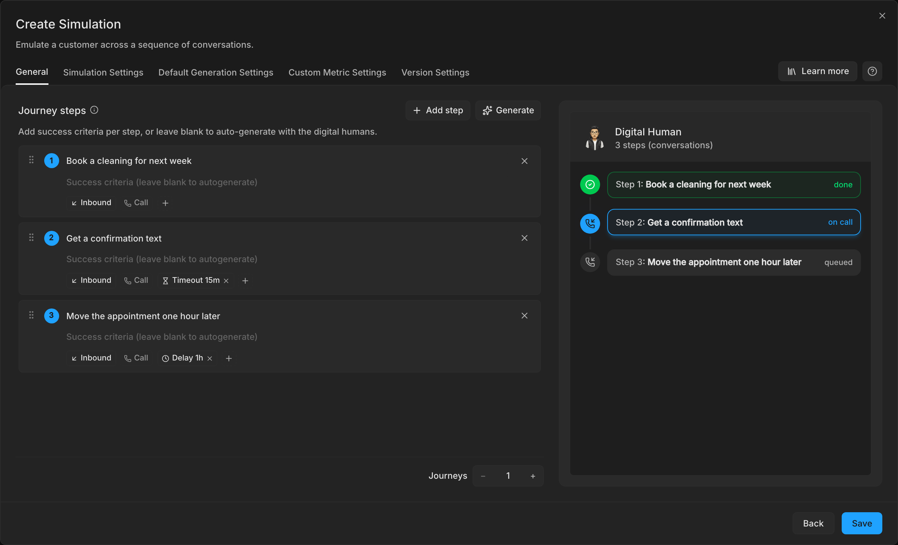
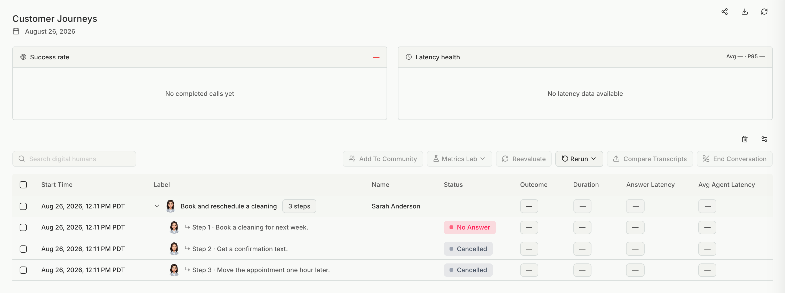
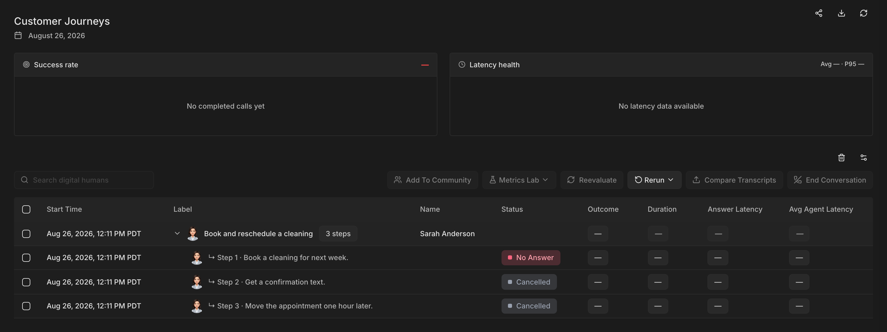

Use this type when one conversation depends on an earlier one, for example a customer who books an appointment and later reschedules it.

<iframe
  src="https://www.youtube.com/embed/MywLdzH9J3g"
  width="100%"
  height="450"
  frameBorder="0"
  allowFullScreen
  style={{ borderRadius: '0.5rem' }}
></iframe>

## Set it up

<Steps>
  <Step title="Pick the type">
    [Create a simulation](/test/simulations/create#pick-a-type-yourself) and pick **Customer Journeys** under **Or pick a type yourself**.
  </Step>
  <Step title="Add the steps">
    Add one step per conversation, in the order the customer has them. Give each step an intent, such as "Book appointment" and then "Reschedule". Each journey is one Digital Human that runs every step in order as the same customer.

    
    
  </Step>
  <Step title="Check each step's direction">
    For an agent on a phone line, a new call step starts in the agent's own direction. So an outbound agent's steps start as **Outbound**. Switch a step to **Inbound** when the customer calls in.
  </Step>
</Steps>

## Results

If a step ends with one of these statuses, Bluejay cancels the later steps of that journey with the code `STEP_SKIPPED`:

- No Connection
- No Answer
- Call Dropped
- Out of Funds
- System Error

## Limits

- An **SMS** step needs an agent that can send text messages.
- An **Outbound** SMS step cannot come directly after another SMS step.
- A journey always runs as the baseline, even if it has [personas](/test/simulations/digital-humans#runs-as).

## Related

- [Error codes](/test/simulations/reference#error-codes)
- [Simulation API](/api-reference/endpoint/create-simulation)
