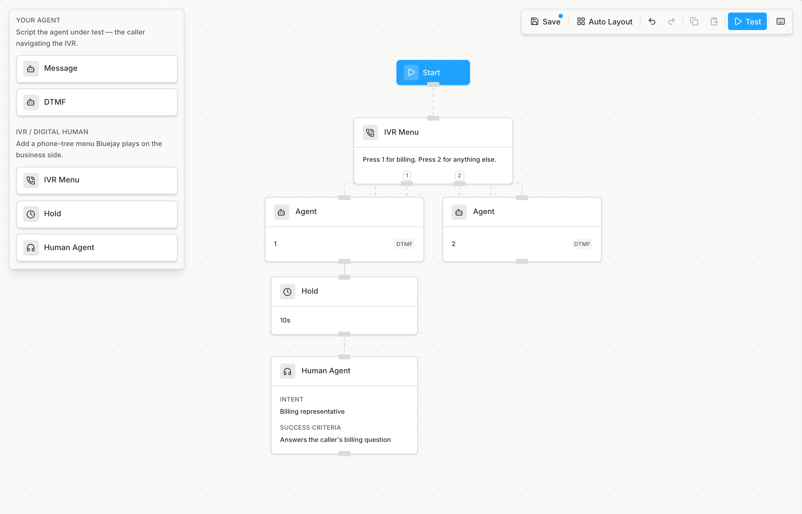
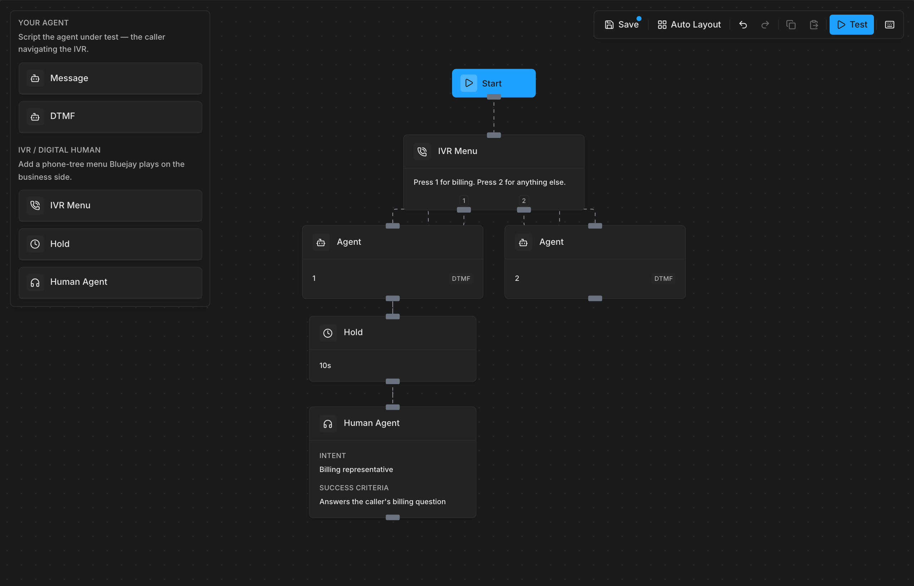

Use this type when your agent calls businesses that answer with a phone menu, for example "Press 1 for billing".

## Build the flow

In **Scenario Builder**, draw the phone menu and what your agent does at each step. The Digital Human plays this menu, and your agent calls through it.

For a full example, see [Test an Agent That Calls Through a Phone Menu](/cookbook/ivr-phone-menu).

## Run it

<Steps>
  <Step title="Pick the type">
    [Create a simulation](/test/simulations/create#pick-a-type-yourself) and pick **IVR Flow** under **Or pick a type yourself**.
  </Step>
  <Step title="Pick the IVR Flows">
    Each IVR Flow becomes one Digital Human that goes through the whole phone menu in one call.
  </Step>
</Steps>

## Limits

- Outbound voice agents only.

## Related

- [Scenario Adherence](/test/simulation-types/scenario-adherence)
- [Scenario API](/api-reference/endpoint/create-scenario)
