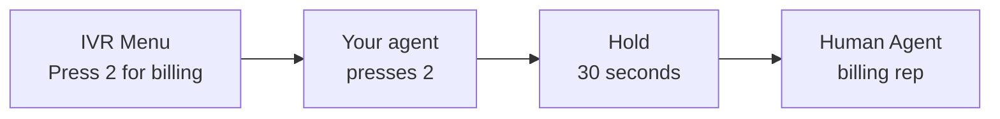

The Digital Human plays a phone menu you build in **Scenario Builder**, and your agent calls through it.

## Build the flow

In Scenario Builder, draw the phone tree and what your agent does at each step:

For a full example, see [Test an Agent That Calls Through a Phone Menu](/cookbook/ivr-phone-menu).

## Run it

<Steps>
  <Step title="Pick the IVR Flows">
    Click **Test** in the Scenario Builder toolbar, or [create a simulation](/test/simulations/create#create-a-simulation) and click the **IVR Flow** card. Select one or more IVR Flows, then click **Save** and **Generate Digital Humans**. Each IVR Flow becomes one Digital Human that goes through the whole phone tree in one call.
  </Step>
</Steps>

## Limits

- Outbound voice agents only. For an inbound agent, or for a chat, SMS, or email agent, the card is disabled.

## Related

- [Scenario Adherence](/test/simulation-types/scenario-adherence)
- [Scenario API](/api-reference/endpoint/create-scenario)
