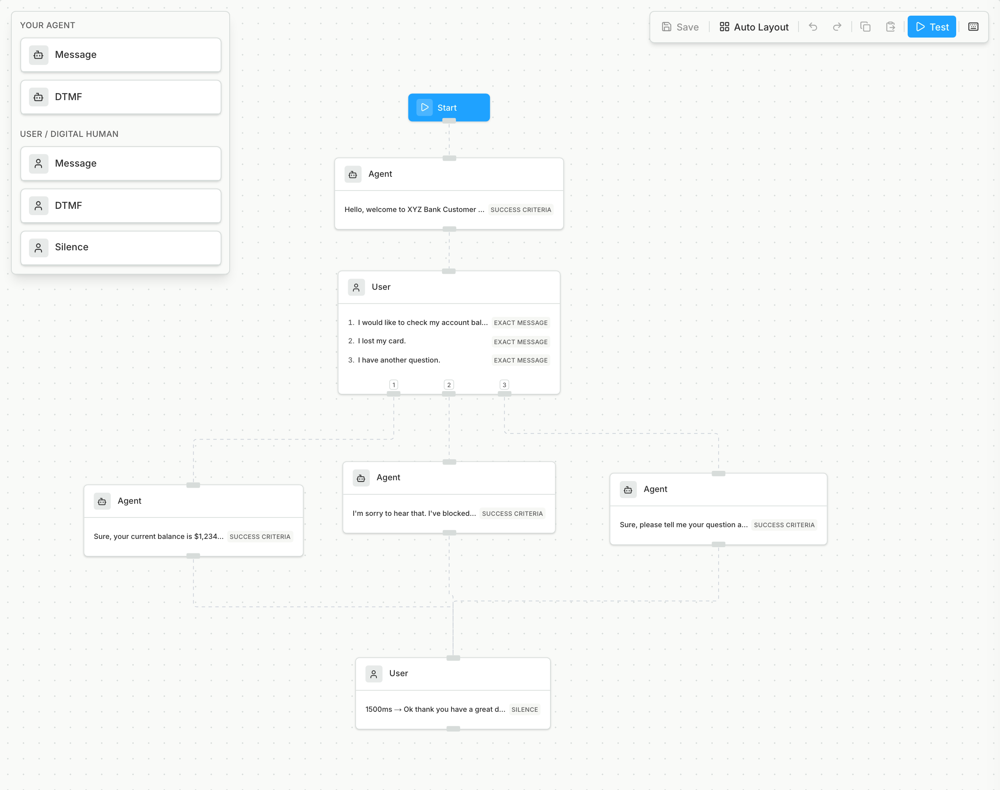
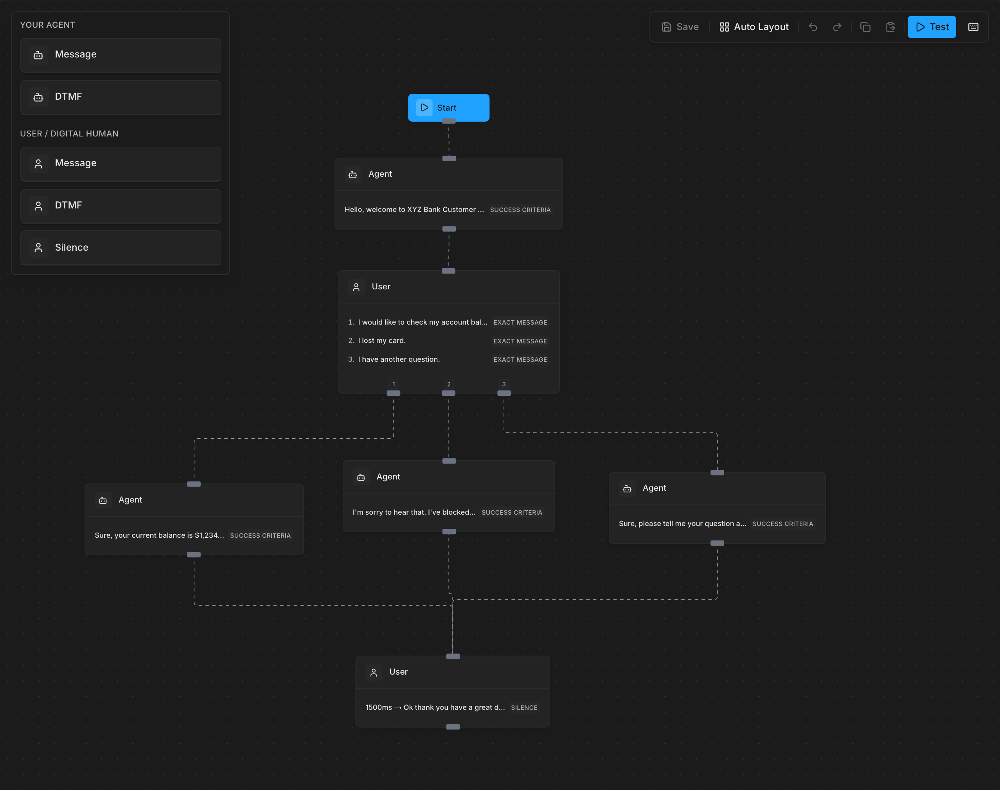

A scenario is a script you draw, step by step: what the agent should say, what the caller says back, and where the call can branch. Bluejay sends one Digital Human down each branch and checks that your agent stays on the script.

<video controls muted playsInline preload="metadata" className="w-full aspect-video rounded-xl" src="/videos/sim-type-scenario-adherence.mp4"></video>

## When to use it

- Use this when your agent must follow fixed steps, like a compliance script or an identity check.
- Use this when you want to see the exact turn where the agent went off script.
- Use [Goal Adherence](/test/simulation-types/goal-adherence) instead when you only care that the job got done, not how.

## How it works

1. You draw the scenario once in **Scenario Builder** (see [Build a scenario](#build-a-scenario)).
2. In the simulation you tick the scenarios to run. Each path from start to end becomes one Digital Human.
3. You add [personas](/test/simulations/personas), or click **Skip personas**. Each path runs once as each persona you pick.
4. On the **Review** page you check the Digital Humans, then run them.

## Build a scenario

Draw the flow as a scenario on the **Scenario Builder** page, and select the agents that it applies to. If you have a [JSON scenario definition](/api-reference/endpoint/create-scenario), import it instead.

- Each path from the start to an end becomes one Digital Human, so each branch you add adds a test.
- Each Digital Human follows its path turn by turn, so you can see where your agent leaves the flow.

## Run it

A scenario with no path from the start cannot be selected, so fix its graph first.

With the API, pass `workflow_adherence_v2`, a map of scenario ID to the number of Digital Humans, to [Generate Digital Humans](/api-reference/endpoint/generate-digital-humans).

## Limits

- Voice agents only.
- Bluejay makes a maximum of 200 Digital Humans for each generate request. Paths beyond that are left out.

## Related

- [IVR Flow](/test/simulation-types/ivr-flow)
- [Scenario API](/api-reference/endpoint/create-scenario)
- [Scenario MCP tools](/mcp/testing-tools#scenarios)
