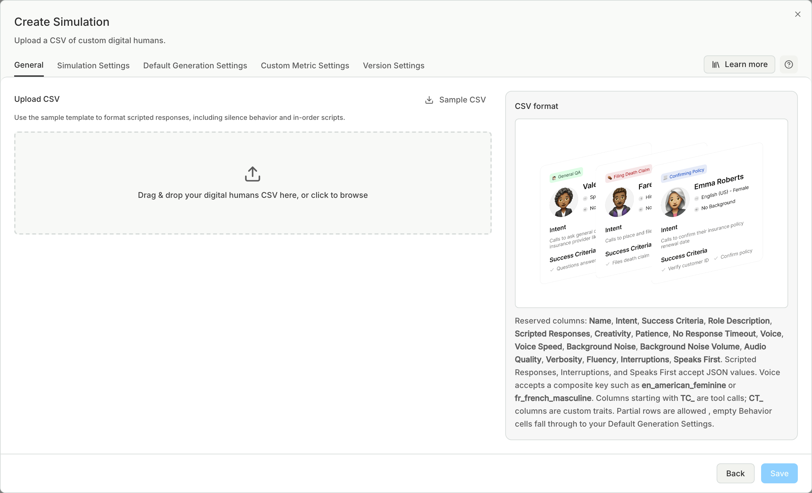
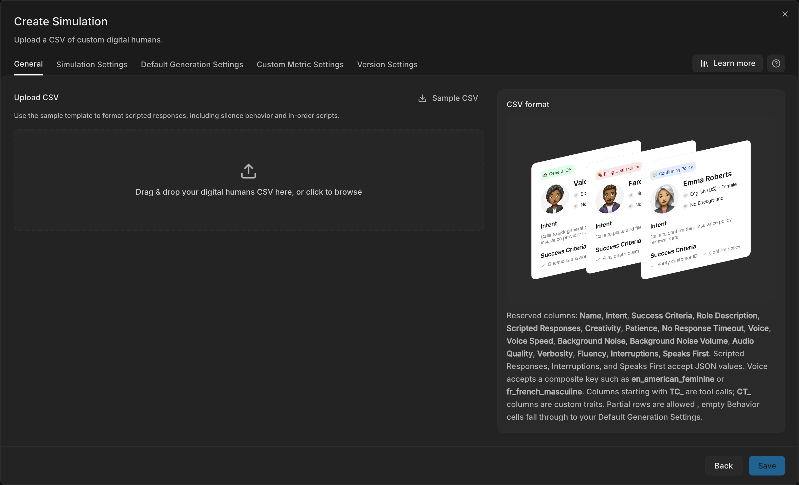

import { Code } from "/snippets/code.jsx";

Upload your test cases when they already live in a spreadsheet. This is the quickest way to start: each row becomes a Digital Human exactly as you wrote it, and nothing is generated or rewritten.

## Set it up

<Steps>
  <Step title="Write the files">
    Write a test cases CSV. To run each test case with several callers, also write a personas CSV: every test case then runs once as each persona, so 5 test cases and 2 personas make 10 calls per run.

    ```csv test_cases.csv
    name,intent,success_criteria
    Reschedule appointment,Caller wants to move their Tuesday appointment to Friday,Agent confirms the new Friday slot
    Cancel subscription,Caller wants to cancel and asks about a refund,Agent cancels and explains the refund policy
    ```

    ```csv personas.csv
    name,personality_description,language,accent,verbosity,background_noise,background_noise_volume
    Rushed commuter,In a hurry on a train. Short answers and asks the agent to speed up.,en,en_american_masculine,low,traffic,0.6
    Careful retiree,Polite and slow. Asks the agent to repeat numbers.,en,en_british_feminine,high,none,0
    ```
  </Step>
  <Step title="Drop them in">
    [Create a simulation](/test/simulations/create#bring-your-test-cases) and drop or attach the files in the request box. Bluejay skips the planning and goes straight to the Digital Humans, which you review before you run.
  </Step>
</Steps>

Bluejay tells the files apart by their header row. A file with `intent` is test cases, and a file with `name` and a persona column such as `personality_description` is personas. A file with both is a [Digital Humans CSV](#digital-humans-csv).

Each test case becomes a Digital Human on your **Test Cases** tab, and the personas are saved to your **Personas** tab. A persona with the same name as one you have updates that persona.

## Test cases columns

`name` and `intent` are required. `success_criteria` takes one check per line in the cell. The `TC_<tool>` and `CT_<trait>` columns below work here too.

## Personas columns

`name` is required. The other columns are `personality_description`, `language`, `accent`, `voice_speed`, `verbosity`, `background_noise` and `background_noise_volume`, with the same values as in the [table below](#columns).

## Digital Humans CSV

The older format still works: one file, one Digital Human in each row, with every column below. Bluejay creates each row exactly as you wrote it.

Check any error before you go on, because Bluejay imports a row without the fields that are not valid.




## Columns

- Column headers are not case-sensitive.
- Bluejay ignores columns that it does not know.
- A blank behavior cell uses the values on the **Default Generation Settings** tab.

| Column | Values |
|---|---|
| `Name` | Text. If blank, Bluejay generates a name. |
| `Intent` | Text |
| `Success Criteria` | Text. Put each bullet on its own line in the cell. |
| `Role Description` | Text |
| `Phone Number` | A number your organization owns. If the number is not owned or cannot be read, Bluejay skips the row. If blank, Bluejay assigns a number. |
| `Scripted Responses` | A JSON object or array |
| `Scripted Responses In Order` | `true` or `false` |
| `Creativity` | 0 to 1 |
| `Patience` | Seconds |
| `No Response Timeout` | Seconds |
| `Voice` | A voice key, for example <Code>en_british_feminine</Code> |
| `Interruptions` | JSON, see below |
| `Speaks First` | JSON, for example `{"speaks_first": true, "mode": "custom", "message": "Hi, I am calling about my bill."}` |
| `TC_<tool>` | An expected tool call. A string is the expected output. |
| `CT_<trait>` | The value of a [trait](/test/simulations/digital-humans#traits) |

These columns take the same values as the [behavior fields](/test/simulations/personas#behavior):

- `Voice Speed`
- `Background Noise`
- `Background Noise Volume`
- `Audio Quality`
- `Verbosity`
- `Fluency`

The `Interruptions` cell is a JSON object with `interruptions_type`:

- `{"interruptions_type": "none"}`
- `{"interruptions_type": "probabilistic", "probability_of_default_interrupt": 0.5}`, with a value from 0 to 1
- `{"interruptions_type": "keyword", "keyword_responses": {"refund": {"response": "Yes, the refund!", "probability": 0.8}}}`
- `{"interruptions_type": "llm", "llm_prompt": {"user_prompt": "Interrupt when the agent talks too long."}}`

<Warning>
  If a JSON cell has unescaped quotes, Bluejay repairs it and shows an "Auto-corrected" message. A repaired cell can have the wrong value. Check those Digital Humans before you run the simulation.
</Warning>

## Related

- [Personas](/test/simulations/personas)
- [Digital Human Reference](/test/simulations/digital-humans)
- [Digital Humans API](/api-reference/endpoint/create-digital-humans)
