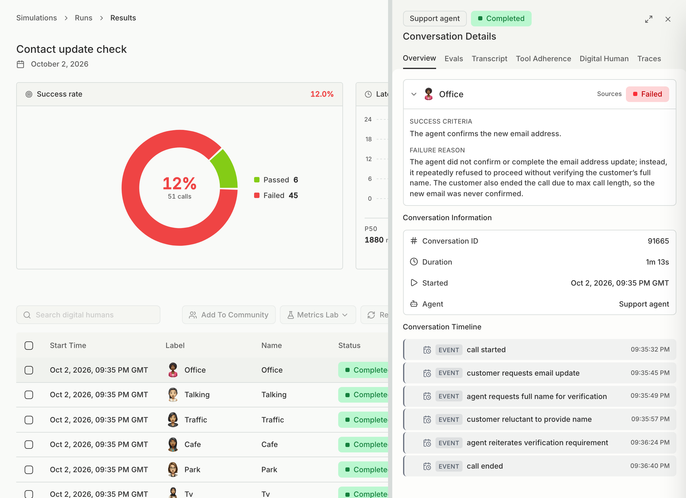
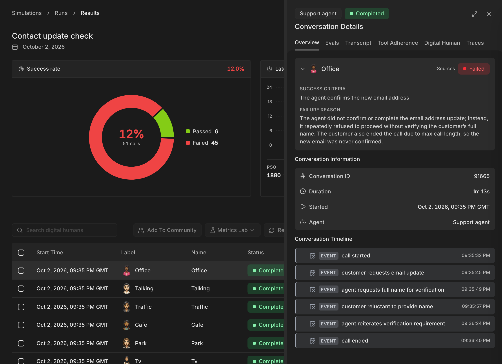

A simulation calls your agent with Digital Humans, which are realistic test customers, and scores each conversation. Tell Bluejay what to test, and it writes a plan you can edit before anything runs.

<video controls muted playsInline preload="metadata" className="w-full rounded-xl" src="/videos/create-simulation-plan.mp4"></video>

<Tip>
Already have test cases? [Upload them](#bring-your-test-cases). Each one becomes a Digital Human exactly as you wrote it, with no planning step.
</Tip>

## Connect your agent

<Steps>
  <Step title="Add the agent">
    Switch to the [workspace](/administration/workspaces#what-a-workspace-holds) you will test in, click **+** in the sidebar header, and connect your agent the way your customers reach it. [Connect Your Agent](/integrations/overview) lists the setup page for each voice, chat, and email connection.
  </Step>
  <Step title="Say who starts the conversation">
    Choose **Inbound** if your customers contact the agent, or **Outbound** if the agent contacts them. For an outbound voice or text agent, add an [outbound trigger webhook](/test/simulations/reference#outbound-trigger-webhook) so Bluejay can tell your agent whom to call or message.

    Paste the agent's system prompt too. Bluejay reads it to write test cases that fit your agent.
  </Step>
</Steps>

Testing an email agent? Make sure its inbox [accepts mail from Bluejay](/integrations/email#allow-bluejays-mail) first.

## Plan the simulation

<Steps>
  <Step title="Say what to test">
    Open **Simulations**, click **Create**, and describe what you want tested, for example "Test booking and rescheduling" or "Test all of my agent's handoffs".

    - Type `@` to point the plan at something specific in Bluejay, such as a call or a Digital Human.
    - Drop in files the plan should follow, such as a spec, a PDF or a folder of transcripts.
    - **Effort** sets how deep the plan goes. **High** writes more test cases and runs each Digital Human twice.
  </Step>
  <Step title="Read the plan">
    Bluejay reads what it can about your agent before it writes: the prompt, its workflow, its Knowledge Base, your existing test cases, recent production calls and past runs. The plan lists the test cases by topic, the [personas](/test/simulations/personas) that will call, and where each test came from, so you can check it against your agent.
  </Step>
  <Step title="Change what you want">
    Ask for changes in the chat beside the plan, such as "add a test where the caller has no order number". You can also type straight into the plan, or select text and leave a comment for your team or for `@Bluejay`.

    <video controls muted playsInline preload="metadata" className="w-full rounded-xl" src="/videos/plan-comment.mp4"></video>

    Each change saves a new version. Pick an earlier version from the clock menu to see what changed since then.
  </Step>
  <Step title="Generate and run">
    Click **Generate digital humans**. Each test case becomes a Digital Human that runs as the plan's personas. Review them by test case or by persona, set the run options in **Settings**, then click **Run**.
  </Step>
</Steps>

When you run, the plan's Digital Humans and personas are saved to the **Test Cases** and **Personas** tabs of the **Digital Humans** page, so the next simulation can reuse them. To test the same callers again after you change the agent, open the simulation and click **Create New Run**.

### Bring your test cases

To build from something you already have, drop it in the request box and Bluejay skips the planning:

- A test cases CSV becomes one Digital Human per row. Add a personas CSV and each of them runs as every persona. See [Upload CSV](/test/simulation-types/upload-digital-humans).
- Call transcripts become Digital Humans that [replay those calls](/test/simulation-types/replay-from-transcript).

## Pick a type yourself

To set up one simulation type by hand, pick it under **Or pick a type yourself** on the **Create** page:

| Type | Use it to |
|---|---|
| [**Goal Adherence**](/test/simulation-types/goal-adherence) | Make Digital Humans from your agent's goals. |
| [**Generate from Knowledge Base**](/test/simulation-types/knowledge-base) | Make Digital Humans from a Knowledge Base. |
| [**Generate from System Prompt**](/test/simulation-types/system-prompt) | Make Digital Humans from your agent's prompt. |
| [**Generate From Workflow**](/test/simulation-types/generate-from-workflow) | Test each path through your agent's multi-agent workflow. |
| [**Customer Journeys**](/test/simulation-types/customer-journeys) | Test how your agent treats returning customers. |
| [**Use Previous Digital Humans**](/test/simulation-types/previous-digital-humans) | Rerun the same Digital Humans across tests. |
| [**Red Teaming**](/test/red-teaming/overview) | Try to break your agent's rules. |
| [**Voicemail**](/test/simulation-types/voicemail) | Test how your agent handles voicemail. |
| [**IVR Flow**](/test/simulation-types/ivr-flow) | Test how your agent gets through a phone menu. |
| [**Scenario Adherence**](/test/simulation-types/scenario-adherence) | Test that your agent follows a required flow. |

## Read the results

Start with the failed conversations to see which metric failed and where it went wrong. A conversation passes only when every one of its [success criteria](/test/simulations/digital-humans#success-criteria) passes. Bluejay groups similar failures into [issues](/test/issues), so you can fix the problem behind many failed conversations at once. To see what your agent did behind the transcript, such as each model call, send [traces](/test/traces).

If a conversation did not finish as **Completed**, look up its code in [Error codes](/test/simulations/reference#error-codes). After you fix the problem, click **Rerun** and choose **Rerun failed**.

To follow your metrics from run to run, chart them on a [dashboard](/test/dashboards).

## Let Bluejay AI do it

You can also ask [Bluejay AI](/improve/bluejay-ai) to create and run the simulation for you. For example:

- "Run a simulation on my agent."
- "Create a simulation with 10 frustrated customers who want to cancel their subscription."

Bluejay AI shows you the Digital Humans it made and asks before it starts the run.

## Related

- [Personas](/test/simulations/personas)
- [Digital Human Reference](/test/simulations/digital-humans)
- [Simulation Reference](/test/simulations/reference)
- [Simulation API](/api-reference/endpoint/create-simulation)
- [Simulation MCP tools](/mcp/testing-tools#simulations)
