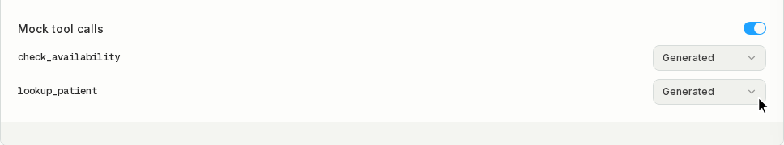
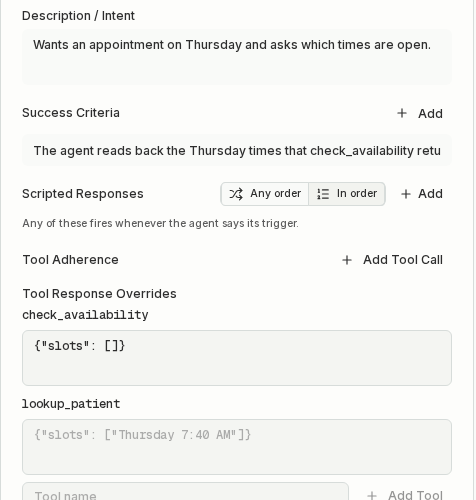

import { Code } from "/snippets/code.jsx";

Use mock tool calls so test runs never create real bookings or read live data, and so each test case gets the result it needs, such as "two slots open on Thursday" or "order not found".

<video controls muted playsInline preload="metadata" className="w-full rounded-xl" src="/videos/mock-tools-overview.mp4"></video>

## How it works

Mocking is set on the agent and applies to every simulation on that agent. Live traffic is never mocked.

1. Open the agent's **Simulation Settings** and turn on **Mock tool calls**. Every tool the agent has is listed.
2. Pick a mode for each tool. Tools start on **Generated**.
3. Run a simulation. Each tool call gets its answer from Bluejay.



| Mode | What the agent gets back |
|---|---|
| Generated | A realistic result Bluejay writes from the tool's name, description and parameters, the call's arguments, and the calling Digital Human. A lookup returns the Digital Human's own name, date of birth and account details. |
| Fixed | The JSON you enter, every time. |
| Real backend | Not mocked. The call goes to your real tool. On Google CES and Dialogflow CX it gets an error result. |

For each tool call, Bluejay uses the first of these:

1. The Digital Human's **Tool Response Overrides** entry for the tool.
2. The agent's **Fixed** response for the tool.
3. A generated result, unless the tool is on **Real backend**.
4. Your real tool.

Generated results usually take a second or two. If generation fails, the tool gets an error result on every platform and your real tool does not run.

## Override a tool for one test case

Edit the Digital Human and fill in **Tool Response Overrides** for the tool, as JSON or plain text. Leave it empty to use the agent's mode.



Overrides are separate from **Tool Adherence**. Tool Adherence grades which tools the agent calls. Overrides only decide what the tools return.

## Example

Your scheduling agent has `check_availability` and `lookup_patient`. You want to test that it reads back the times your calendar returns.

1. Turn on **Mock tool calls** in the agent's **Simulation Settings**.
2. Set `check_availability` to **Fixed** with `{"slots": ["Thursday 7:40 AM", "Thursday 4:05 PM"]}`. Leave `lookup_patient` on **Generated**.
3. Create a Digital Human who asks for a Thursday appointment, with the success criterion "The agent reads back the Thursday times that check_availability returned."

The agent gets the Digital Human's own details from the lookup, and Thursday at 7:40 AM and 4:05 PM from the availability check. No real calendar or patient record is read.

<video controls muted playsInline preload="metadata" className="w-full rounded-xl" src="/videos/mock-tools-elevenlabs-e2e.mp4"></video>

To test a fully booked day in one test case, give that Digital Human an override for `check_availability` of `{"slots": []}`.

## Set up by platform

| Platform | Web or chat simulations | Phone or SIP simulations |
|---|---|---|
| ElevenLabs | Native | Your tool server asks Bluejay |
| Google CES, Dialogflow CX | Native for tools Bluejay runs | Not supported natively |
| Retell, Vapi | Your tool server asks Bluejay | Your tool server asks Bluejay |
| Bland | Not supported natively | Your tool server asks Bluejay |
| LiveKit, Pipecat, your own code | Bluejay SDK helper | Bluejay SDK helper |

"Native" means you only turn on **Mock tool calls**. "Your tool server asks Bluejay" means your tool handler calls the [resolver](#retell-vapi-and-other-platforms) before it runs the real tool.

### ElevenLabs

Bluejay mocks ElevenLabs agents natively on web and chat simulations. Your agent needs versioning turned on in ElevenLabs.

<video controls muted playsInline preload="metadata" className="w-full rounded-xl" src="/videos/mock-tools-elevenlabs-toggle.mp4"></video>

When you turn mocking on, Bluejay creates a branch named `bluejay-mocks` on the agent in your ElevenLabs workspace.

- The branch is a copy of your live version. It has a client tool in place of each webhook tool, with the same name and schema. Tools on **Real backend** stay webhooks and call your server.
- The branch takes 0% of traffic. Live callers and your main version are never touched.
- Bluejay reuses the branch for every run. When you publish a new live version, Bluejay rebuilds the branch the next time you queue a run. Changing a tool to or from **Real backend** rebuilds it right away.
- Don't edit the branch. Bluejay overwrites it.

In a simulation, every tool call comes back to Bluejay instead of your server, including calls the agent makes early or drops after an interruption. If Bluejay can't produce a result, the tool gets the error "No mock result is available for this tool in this test."

<video controls muted playsInline preload="metadata" className="w-full rounded-xl" src="/videos/mock-tools-elevenlabs-output.mp4"></video>

<video controls muted playsInline preload="metadata" className="w-full rounded-xl" src="/videos/mock-tools-elevenlabs-run.mp4"></video>

To turn mocking off, turn off **Mock tool calls**. Bluejay archives the branch and deletes its tool copies. Turning it on again creates a new branch.

ElevenLabs phone and SIP agents use the [resolver](#retell-vapi-and-other-platforms), because ElevenLabs can't route a phone call to a branch. Bluejay sends `X-Simulation-Result-Id` on every SIP call. Pass it to your tool webhook as a dynamic variable.

### Google CES and Dialogflow CX

When Google hands a tool call to Bluejay during a simulation, Bluejay answers it. This works for voice and chat.

- A tool on **Real backend** gets an error result, since nothing can run your real tool on this path.
- A result that is not a JSON object arrives as `{"result": <value>}`.
- Tools that Google runs itself, such as OpenAPI tools, still call your real system. Bluejay can't mock them yet.

### Retell, Vapi and other platforms

Your tool server asks Bluejay for the mock before it runs the real tool.

1. Read the Bluejay test id from the call.
2. Call `POST /v1/tool-mocks/resolve` with your Bluejay API key.
3. If `mocked` is true, return `result` and skip the real tool. On `mocked: false`, run the real tool.

| How Bluejay reaches your agent | Test id |
|---|---|
| Retell or Vapi web call | The call's metadata, <Code>metadata.test_result_id</Code>. Retell and Vapi include the call in tool requests. |
| SIP | The `X-Simulation-Result-Id` header. |
| Phone number | No id. Send the Digital Human's phone number as `caller_number`. |

A Retell custom function with FastAPI:

```python
import os, httpx
from fastapi import FastAPI

app = FastAPI()

@app.post("/check_availability")
def check_availability(body: dict):
    test_id = (body["call"].get("metadata") or {}).get("test_result_id")
    if test_id:
        try:
            r = httpx.post("https://api.getbluejay.ai/v1/tool-mocks/resolve", timeout=10,
                headers={"X-API-Key": os.environ["BLUEJAY_API_KEY"]},
                json={"tool_name": "check_availability", "arguments": body["args"], "test_result_id": int(test_id)})
            r.raise_for_status()
            data = r.json()
        except Exception:
            return {"error": "This tool is unavailable in this test."}
        if data.get("mocked"):
            return data["result"]
    return my_calendar.slots(**body["args"])
```

- Only call Bluejay when the call has a test id or comes from a Bluejay number. Real callers then never wait on Bluejay.
- When the call has a test id and Bluejay errors or times out, return an error result instead of running the real tool, so a test never reaches your real backend. Generated results can take a few seconds, so wait up to 10.

### Phone

No platform routes a Bluejay caller to a test version on its own, so phone tests always need your tool server to ask Bluejay. Use the resolver or the [SDK helper](#sdk-helper).

- SIP calls carry `X-Simulation-Result-Id`. Send it as `test_result_id`.
- Phone calls drop SIP headers. Send the Digital Human's phone number as `caller_number`, in E.164 form. Bluejay matches it to the Digital Human calling from that number right now.
- When your agent calls the Digital Human, the Digital Human's number is the number your agent dialed.

### LiveKit and Pipecat

When your tools run in your own code, wrap each tool with the Bluejay SDK helper. During a Bluejay simulation it returns the mocked result. On any other call it runs your real tool.

```bash
pip install bluejay-sdk
export BLUEJAY_API_KEY=<your Bluejay API key>
```

For LiveKit, add `@mockable` under `@function_tool`, and call `bind_livekit(ctx)` at the start of your entrypoint.

```python
from bluejay.helpers.tool_mocks import bind_livekit, mockable

class Scheduler(Agent):
    @function_tool
    @mockable
    async def check_availability(self, day: str) -> str:
        return await my_calendar.slots(day)

async def entrypoint(ctx: JobContext):
    bind_livekit(ctx)
    ...
```

The mock is looked up by the function name. If your tool has a different name in Bluejay, use `@mockable(name="check_availability")`.

For Pipecat, bind the call when the bot starts, then wrap the handler body with `mock_or_call`.

```python
from bluejay.helpers.tool_mocks import bind, mock_or_call

async def bot(args):
    bind(test_result_id=args.body.get("X-Simulation-Result-Id"))
    ...

async def check_availability(params):
    result = await mock_or_call("check_availability", params.arguments, lambda: my_calendar.slots(**params.arguments))
    await params.result_callback(result)
```

How the helper finds the call:

- `bind_livekit` reads `X-Simulation-Result-Id` from the dispatch metadata, then from participant attributes. For SIP calls into LiveKit, map the header with `headers_to_attributes` on your inbound trunk.
- On plain phone calls the header is dropped, so `bind_livekit` falls back to the caller's number, `sip.phoneNumber`.
- In any other server, call `bind(test_result_id=...)` or `bind(caller_number=...)` yourself.

## API and MCP

The endpoints authenticate with your Bluejay API key in the `X-API-Key` header. They only see agents and simulations in the [workspaces](/administration/workspaces) your key can access.

With MCP or Bluejay AI, ask "mock tool calls for my scheduling agent", then "make check_availability return Thursday 7:40 AM and 4:05 PM". The tools are `set_agent_mock_tools` and `set_agent_tool_mock`.

### Turn mocking on or off

`PUT https://api.getbluejay.ai/v1/agents/{agent_id}/mock-tools`

Needs write access to the agent's workspace.

```bash
curl -X PUT https://api.getbluejay.ai/v1/agents/$AGENT_ID/mock-tools \
  -H "X-API-Key: $BLUEJAY_API_KEY" -H "Content-Type: application/json" \
  -d '{"enabled": true, "tools": {"check_availability": {"mode": "fixed", "response": {"slots": ["Thursday 7:40 AM"]}}}}'
```

| Request field | Type | Meaning |
|---|---|---|
| `enabled` | boolean | Mock tool calls in every simulation on this agent. Required. |
| `tools` | object | Per-tool settings keyed by tool name. Replaces the stored set. Leave it out to keep the stored set. Tools not listed are generated. |

Each tool setting:

| Field | Type | Meaning |
|---|---|---|
| `mode` | string | `generated` (default), `fixed` or `real`. |
| `response` | any | For `fixed`, the result returned every time. |
| <Code>response_schema</Code> | object | JSON Schema the result must match. A `fixed` tool with a schema and no response gets a generated value that matches it. |

| Response field | Type | Meaning |
|---|---|---|
| `agent_id` | integer | The agent. |
| `enabled` | boolean | Whether mocking is now on. |
| `tools` | object | The stored per-tool settings. |
| <Code>eleven_labs_branch_id</Code> | string or null | The `bluejay-mocks` branch, for ElevenLabs agents turned on. |

For ElevenLabs agents, a 400 means the agent has no versions, so turn on versioning in ElevenLabs first. A 502 means a call to the ElevenLabs API failed, and mocking stays as it was. Queuing a voice run also updates the branch to match the live agent and its tools. If that update fails, the run is not queued and the queue request answers 502.

The MCP tool `set_agent_mock_tools` takes `agent_id` and `enabled`, and returns the same fields.

### Set one tool

`PUT https://api.getbluejay.ai/v1/agents/{agent_id}/mock-tools/{tool_name}`

The body is one tool setting, such as `{"mode": "fixed", "response": {"slots": []}}`. It also turns mocking on for the agent, and returns the same fields as above. The MCP tool is `set_agent_tool_mock`.

Digital Human overrides are the `tool_responses` field, an object keyed by tool name, when you [create](/api-reference/endpoint/create-digital-human) or [update](/api-reference/endpoint/update-digital-human) a Digital Human.

### Resolve a mock

`POST https://api.getbluejay.ai/v1/tool-mocks/resolve`

Call it from your tool server before you run the real tool.

```bash
curl -X POST https://api.getbluejay.ai/v1/tool-mocks/resolve \
  -H "X-API-Key: $BLUEJAY_API_KEY" -H "Content-Type: application/json" \
  -d '{"tool_name": "check_availability", "arguments": {"day": "Thursday"}, "test_result_id": 125145}'
```

```json
{"mocked": true, "result": {"slots": ["Thursday 7:40 AM", "Thursday 4:05 PM"]}}
```

| Request field | Type | Meaning |
|---|---|---|
| `tool_name` | string | The tool the agent called. Required. |
| `arguments` | object | The arguments the agent passed. Default `{}`. |
| <Code>test_result_id</Code> | integer | The Bluejay test id, from `X-Simulation-Result-Id` or <Code>metadata.test_result_id</Code>. |
| <Code>caller_number</Code> | string | The Digital Human's phone number in E.164 form, for phone calls. Used only when `test_result_id` is missing. |
| `description` | string | What the tool does. Optional. |
| `parameters_schema` | object | JSON Schema of the tool's arguments. Optional. |
| `response_schema` | object | JSON Schema the generated result follows. Optional. |

Send `description` and the schemas to mock a tool without registering it in Bluejay. Each one takes precedence over what Bluejay has stored for that tool, so the mock stays in step with your code.

| Response field | Type | Meaning |
|---|---|---|
| `mocked` | boolean | True when this is a Bluejay test, the agent has mocking on, and the tool is not on `real`. |
| `result` | any | The result. Return it as the tool result. |

- When the call is a Bluejay simulation and Bluejay can't produce a result, the answer is `mocked: true` with the result `{"error": "This tool is unavailable in this test."}`.
- `caller_number` matches the Digital Human with that number whose conversation is running now. If none is running, the answer is `mocked: false`.
- An unknown id, an id from another organization, and an id from a workspace your key can't read all answer `mocked: false`. Bluejay never reveals whether the id exists.
- The limit is 600 requests per minute per organization. Over it, the endpoint answers 429. Treat a 429 like any other error: return an error result when the call has a test id, otherwise run the real tool.

## SDK helper

The helpers are in `bluejay.helpers.tool_mocks` in the `bluejay-sdk` Python package.

| Name | What it does |
|---|---|
| `mockable` | Decorator for a tool. Pass `name=` when the Bluejay tool name differs from the function name. |
| <Code>bind_livekit(ctx)</Code> | Identifies the call from a LiveKit `JobContext`. |
| <Code>bind(test_result_id=, caller_number=)</Code> | Identifies the call yourself, in any server. |
| <Code>mock_or_call(tool_name, arguments, real_fn)</Code> | Returns the mocked result, or the result of `real_fn()`. |

| Environment variable | Default | Meaning |
|---|---|---|
| <Code>BLUEJAY_API_KEY</Code> | none | Required. Without it, calls with a test id get the error result and other calls run the real tool. |
| <Code>BLUEJAY_MOCK_TIMEOUT_SECONDS</Code> | `1.5` | How long the helper waits for Bluejay on calls identified only by caller number. Calls with a test id wait 10 seconds. |
| <Code>BLUEJAY_API_URL</Code> | <Code>https://api.getbluejay.ai/v1</Code> | The Bluejay API base URL. |

The helper fails closed on tests:

- A call with no test id and no caller number never contacts Bluejay.
- With a test id, a lookup that fails, times out, or answers 429 returns `{"error": "This tool is unavailable in this test."}`. Your real tool never runs.
- With only a caller number, the call may be a real caller, so a failed lookup runs your real tool.
- A mocked result is returned as a string. Objects are JSON-encoded.

## Which calls reach your real tool

| Platform | Mocked tool | Tool on Real backend |
|---|---|---|
| ElevenLabs web or chat, native | Mocked result | Real tool runs |
| ElevenLabs phone or SIP, resolver | Mocked result | Real tool runs |
| Google CES, Dialogflow CX | Mocked result | Error result |
| Resolver or SDK helper | Mocked result | Real tool runs |

## Related

- [Digital Human Reference](/test/simulations/digital-humans)
- [Create a Simulation](/test/simulations/create)
